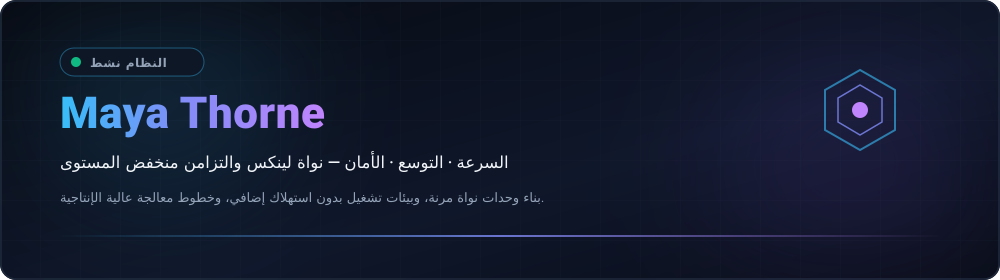
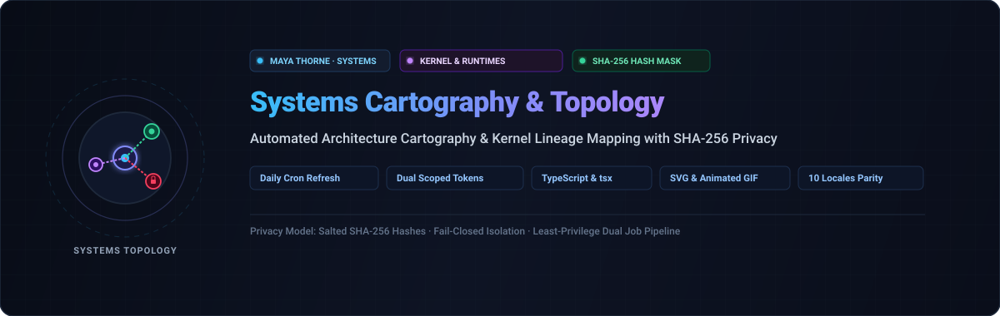
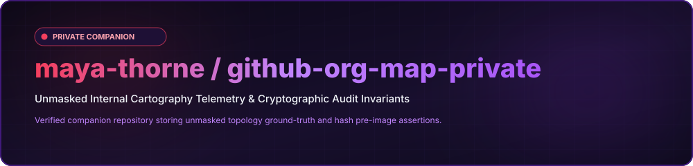
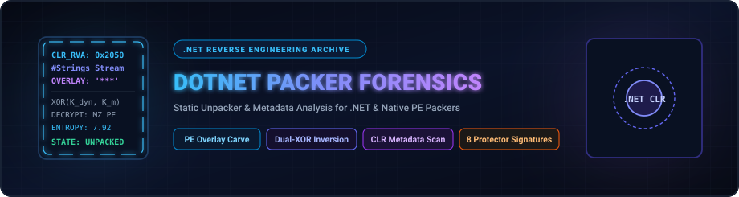
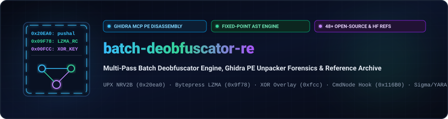
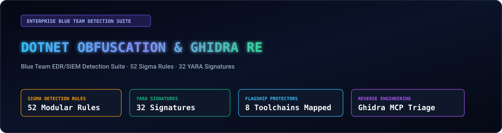
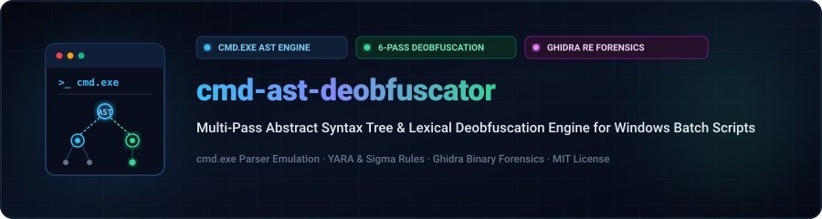
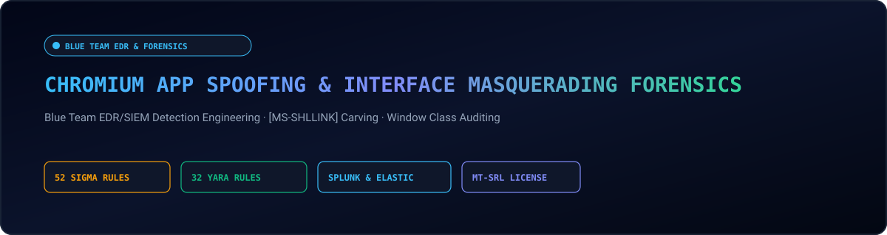
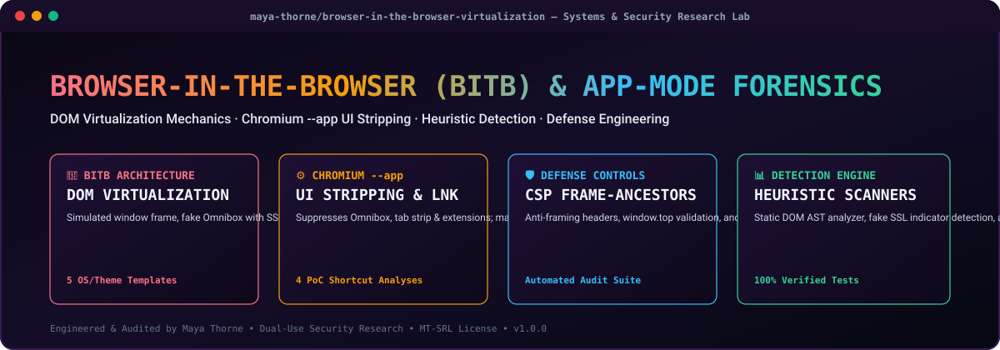
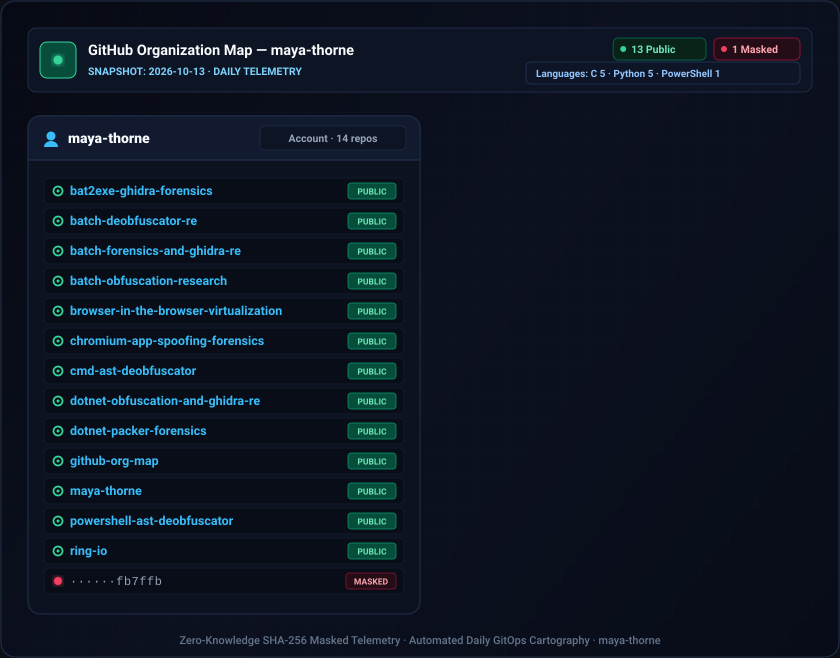

  
  

  <strong>Architecting Resilient Low-Level Systems, Kernel Modules &amp; High-Throughput Concurrency Primitives.</strong> 
  Speed · Scale · Security — Engineering with clarity and conviction. 🚀 ( •̀ᴗ•́ )و

  <a href="../README.md">🇺🇸 English</a> · <a href="./ko.md">🇰🇷 한국어</a> · <a href="./zh-CN.md">🇨🇳 中文</a> · <a href="./es.md">🇪🇸 Español</a> · <a href="./hi.md">🇮🇳 हिन्दी</a> 
  <strong>🇸🇦 العربية</strong> · <a href="./pt-BR.md">🇧🇷 Português</a> · <a href="./ru.md">🇷🇺 Русский</a> · <a href="./fr.md">🇫🇷 Français</a> · <a href="./id.md">🇮🇩 Bahasa Indonesia</a>

  
  
  
  

---

<!-- شريط التنقل السريع -->

  <a href="#about-engineering-ethos"><b>⚡ نبذة</b></a> &nbsp;•&nbsp;
  <a href="#core-systems-architecture"><b>🚀 عرض 13 مستودعاً</b></a> &nbsp;•&nbsp;
  <a href="#featured-capabilities"><b>⚙️ القدرات</b></a> &nbsp;•&nbsp;
  <a href="#technology-stack"><b>💻 المكدس التقني</b></a> &nbsp;•&nbsp;
  <a href="#explore-projects"><b>🗺️ خارطة الطريق</b></a> &nbsp;•&nbsp;
  <a href="#architecture-dashboard"><b>📊 المقاييس</b></a> &nbsp;•&nbsp;
  <a href="#repository-structure"><b>📂 الهيكل</b></a>

---

<h2 style="display:inline-block; margin:0;">⚡ About &amp; Engineering Ethos</h2>

 

Architecting resilient low-level software systems, Linux kernel modules, and high-throughput concurrency primitives. Engineering centered around mechanical sympathy and zero-overhead performance:

- ⚡ **Zero-Cost &amp; Mechanical Sympathy** — Code engineered to respect CPU cache hierarchies, memory alignment, and branch predictors. Zero-overhead abstractions by default.
- 🐧 **Kernel-First Architecture** — Treating the operating system kernel not as an opaque abstraction, but as the foundational runtime. Deep instrumentation with io_uring, eBPF, and lockless queues.
- 🛡️ **Invariant-Driven Correctness** — Compile-time safety guarantees, deterministic finite-state machine transitions, lock-free ring buffers, and continuous fuzzing validation.

  <em>(⌐■_■) 💻 "In the terminal we trust. Make it deterministic. Automate the friction away."</em>

---

<h2 style="display:inline-block; margin:0;">🚀 Core Systems & Infrastructure Architecture</h2>

 

بيئات تشغيل موزعة فائقة الأداء، وأساسيات شبكية تتجاوز النواة، ومحركات طوبولوجيا البنية التحتية الموثقة تشفيرياً عبر 5 مجالات بحثية رئيسية:

### ⚡ أنظمة المستوى المنخفض والأساسيات البرمجية للنواة

<table>
  <tr>
    <td width="50%" valign="top">
      

        
      

      <h4><a href="https://github.com/maya-thorne/ring-io">⚡ ring-io</a></h4>
      
<em>محرك إدخال/إخراج غير متزامن فائق الإنتاجية وبدون عبء إضافي عبر Linux io_uring بمعيار (C23).</em>

      

        
        
        
      

      <ul>
        <li>🌀 <strong>طابور حلقي بلا استدعاءات نظام</strong>: مخازن مؤقتة حلقية خالية من القفل للتقديم (SQ) والإكمال (CQ)</li>
        <li>⚡ <strong>محرك استطلاع النواة</strong>: خيوط معالجة SQPOLL في النواة تحقق 2.85 مليون عملية بالثانية</li>
        <li>🔒 <strong>ذاكرة حتمية</strong>: معمارية C23 نقية، وتوافق تام مع خطوط الذاكرة المؤقتة (Cache-Aligned)</li>
      </ul>
    </td>
    <td width="50%" valign="top">
      

        
      

      <h4><a href="https://github.com/maya-thorne/github-org-map">🗺️ github-org-map</a></h4>
      
<em>تخطيط طوبولوجي يومي مؤتمت لمستودعات نواة لينكس والتزامن البرمجي مع تشفير SHA-256 للخصوصية.</em>

      

        
        
        
      

      <ul>
        <li>🔄 <strong>رسم خرائط مستمر</strong>: تدفق عمل GitHub Actions مجدول يرسم تلقائياً مستودعات أبحاث النواة</li>
        <li>🛡️ <strong>إخفاء بالتجزئة أحادية الاتجاه</strong>: تجزئة SHA-256 محصنة لحماية مختبرات استغلال النواة الخاصة</li>
        <li>📊 <strong>قياس عن بُعد متجهي أصيل</strong>: محرك SVG ثنائي الأبعاد نقي بدون مكتبات خارجية يولد مخططات متحركة دقيقة</li>
      </ul>
    </td>
  </tr>
  <tr>
    <td colspan="2" valign="top">
      

        
      

      <h4><a href="https://github.com/maya-thorne/github-org-map-private">🔒 github-org-map-private</a></h4>
      
<em>خط قياس عن بعد معزول لوحدات النواة منخفضة المستوى وتحليل الدفاع ضد الثغرات والبحوث المعمارية الخاصة.</em>

      

        
        
        
      

      <ul>
        <li>🔐 <strong>خزنة مرتبطة بالعتاد</strong>: تشفير Windows DPAPI لحماية البيانات السرية على مستوى العتاد الصلب</li>
        <li>⚡ <strong>توكيدات حتمية</strong>: إطار اختبار آلي يتحقق برمجياً من مقاومة الاصطدام في التجزئة</li>
        <li>📜 <strong>تدقيق مزدوج للحقيقة</strong>: خط تدقيق مستمر يطابق المخططات العامة المموّهة مع الهيكل الداخلي غير المقنع</li>
      </ul>
    </td>
  </tr>
</table>

### 🔬 الهندسة العكسية للملفات الثنائية ومحللات الحزم

<table>
  <tr>
    <td width="50%" valign="top">
      

        
      

      <h4><a href="https://github.com/maya-thorne/bat2exe-ghidra-forensics">🔬 bat2exe-ghidra-forensics</a></h4>
      
<em>هندسة عكسية لملفات PE الثنائية باستخدام Ghidra MCP، وتحليل شفرة 8 أدوات تشويش، ومحرك AST لإزالة التشويش.</em>

      

        
        
        
      

      <ul>
        <li>🔬 <strong>تفكيك PE عبر Ghidra MCP</strong>: تفكيك عميق لملفات Bat2Exe المجمعة بحزم UPX و .NET CLR و VB6</li>
        <li>🛠️ <strong>تشريح 8 أدوات أساسية</strong>: تحليل سطراً بسطر لأدوات BatCloak و Somalifuscator و 0xidiz3r وخطافات Exorcism</li>
        <li>⚡ <strong>محرك AST متعدد المراحل</strong>: أداة تحليل سكوني من 6 مراحل (src/deobfuscator_engine.py) وقواعد Sigma/YARA</li>
      </ul>
    </td>
    <td width="50%" valign="top">
      

        
      

      <h4><a href="https://github.com/maya-thorne/dotnet-packer-forensics">🔬 dotnet-packer-forensics</a></h4>
      
<em>أداة تفريغ جنائي ثابتة بدون تشغيل، وتحليل بيانات CLR الوصفية، واستخراج تراكب PE وأرشيف أبحاث التشفير المزدوج XOR.</em>

      

        
        
        
      

      <ul>
        <li>📑 <strong>استخراج تراكب PE</strong>: كاشف بلغة Python يستخرج الحمولات المخفية الملحقة خارج حدود أقسام PE الفيزيائية</li>
        <li>🔑 <strong>فك تشفير XOR المزدوج</strong>: استخراج تلقائي للمفاتيح وفك تشفير حاويات xorPacker و xorStub المشفرة</li>
        <li>🔍 <strong>تحليل بيانات CLR الوصفية</strong>: بصمة جنائية فورية بدون تشغيل لحزم ConfuserEx و .NET Reactor و Babel</li>
      </ul>
    </td>
  </tr>
  <tr>
    <td colspan="2" valign="top">
      

        
      

      <h4><a href="https://github.com/maya-thorne/batch-deobfuscator-re">🔬 batch-deobfuscator-re</a></h4>
      
<em>محرك إزالة تشويش متعدد المراحل لملفات الدفعات، والتحليل الجنائي لحزم PE في Ghidra، وأرشيف يضم أكثر من 48 مرجعاً.</em>

      

        
        
        
      

      <ul>
        <li>🌀 <strong>مزيل تشويش AST ذو النقطة الثابتة</strong>: مخفض تكراري يفكك تقسيم المتغيرات المتداخلة وتمويه علامات الإقحام</li>
        <li>🗜️ <strong>مستخرج حاويات PE السكوني</strong>: مفكك حزم لطبقات UPX و LZMA و XOR المضمنة داخل المغلفات المجمعة</li>
        <li>📚 <strong>أرشيف شامل</strong>: تشريح لـ 7 محركات إزالة تشويش رائدة مقترناً بأكثر من 48 مستودعاً ومجموعة بيانات ذكاء اصطناعي</li>
      </ul>
    </td>
  </tr>
</table>

### 🛡️ تشويش المترجم وشجرة التحليل النحوي (AST)

<table>
  <tr>
    <td width="50%" valign="top">
      

        
      

      <h4><a href="https://github.com/maya-thorne/batch-obfuscation-research">🛡️ batch-obfuscation-research</a></h4>
      
<em>الأرشيف الرئيسي لبحوث تشويش وإزالة تشويش والهندسة العكسية لملفات دفعات ويندوز على مدار 30 عاماً (1990–2026).</em>

      

        
        
        
      

      <ul>
        <li>📜 <strong>أرشيف تطور يمتد لـ 30 عاماً</strong>: أكثر من 48 مرآة لأدوات مفتوحة المصدر، وأبحاث Mandiant، ومجموعات بيانات الذكاء الاصطناعي</li>
        <li>🧠 <strong>محلل cmd.exe خماسي المراحل</strong>: ورقة بيضاء شاملة حول ترتيب توسيع سطر الأوامر وآلات الحالة ذات المكدس</li>
        <li>🌐 <strong>توثيق بعشر لغات</strong>: توثيق تقني مترجم بالكامل مدعوم بلافتات SVG لمحطة الأوامر الداكنة</li>
      </ul>
    </td>
    <td width="50%" valign="top">
      

        
      

      <h4><a href="https://github.com/maya-thorne/dotnet-obfuscation-and-ghidra-re">🛡️ dotnet-obfuscation-and-ghidra-re</a></h4>
      
<em>هندسة كشف EDR/SIEM للفريق الأزرق، 52 قاعدة Sigma، 32 توقيع YARA، وتحليل CIL الجنائي، وحزمة Ghidra.</em>

      

        
        
        
      

      <ul>
        <li>🛡️ <strong>تحليل dnlib ومقاومة التلاعب الجنائي</strong>: كشف تشفير أساليب JIT، ومسح الذاكرة، وترويسات الجداول التالفة</li>
        <li>⚙️ <strong>إعادة تفكيك CIL في Ghidra</strong>: مسارات هندسة عكسية تكشف حلقات إرسال الآلة الافتراضية الأصلية</li>
        <li>📊 <strong>قواعد أمنية متكاملة لـ SOC</strong>: 52 قاعدة Sigma و 32 توقيع YARA لتغطية تقنيات التهرب من الحماية التجارية</li>
      </ul>
    </td>
  </tr>
  <tr>
    <td colspan="2" valign="top">
      

        
      

      <h4><a href="https://github.com/maya-thorne/cmd-ast-deobfuscator">🛡️ cmd-ast-deobfuscator</a></h4>
      
<em>محرك تحليل شجرة التركيب النحوي (AST) والتحليل المعجمي متعدد المراحل لإزالة تشويش نصوص أوامر ويندوز.</em>

      

        
        
        
      

      <ul>
        <li>🧩 <strong>محلل معجمي متعدد المراحل</strong>: آلة أوتوماتية ذات مكدس لمعالجة إقحام علامات (^)، وتقطيع المتغيرات، والتوسع المؤجل</li>
        <li>⚡ <strong>تطبيع آمن بدون تنفيذ</strong>: معالجة داخل الذاكرة تعيد بناء الأوامر المشوشة دون الحاجة لتشغيل مفسر الأوامر</li>
        <li>🛡️ <strong>خط معالجة جنائي</strong>: تكامل مباشر مع نتائج الهندسة العكسية في Ghidra وتوقيعات القياس عن بُعد</li>
      </ul>
    </td>
  </tr>
</table>

### 🔍 هندسة الكشف الدفاعي والتحليل الجنائي السيبراني

<table>
  <tr>
    <td width="50%" valign="top">
      

        
      

      <h4><a href="https://github.com/maya-thorne/batch-forensics-and-ghidra-re">🛡️ batch-forensics-and-ghidra-re</a></h4>
      
<em>هندسة كشف EDR/SIEM للفريق الأزرق، 52 قاعدة Sigma، 32 توقيع YARA، ومقياس إنتروبيا شانون وكثافة علامة الإقحام.</em>

      

        
        
        
      

      <ul>
        <li>📐 <strong>مقياس إنتروبيا شانون وكثافة علامات الإقحام</strong>: كاشف سكوني بلغة Python لحساب كثافة الرموز والانحراف الإحصائي</li>
        <li>🔍 <strong>تغطية أحداث Sysmon و 4688</strong>: 52 قاعدة Sigma إنتاجية مطابقة لتكتيكات مصفوفة MITRE ATT&CK</li>
        <li>🚀 <strong>محاكي AST دفاعي</strong>: أداة إلغاء هروب الأوامر داخل الذاكرة (src/cmd_parser_simulator.py) للفرز التلقائي</li>
      </ul>
    </td>
    <td width="50%" valign="top">
      

        
      

      <h4><a href="https://github.com/maya-thorne/chromium-app-spoofing-forensics">🛡️ chromium-app-spoofing-forensics</a></h4>
      
<em>هندسة كشف EDR/SIEM، 52 قاعدة Sigma، 32 توقيع YARA، واستخراج ملفات [MS-SHLLINK] وتدقيق تمويه فئات النوافذ.</em>

      

        
        
        
      

      <ul>
        <li>📑 <strong>استخراج ملفات [MS-SHLLINK] الثنائية</strong>: محلل بايثون يستخرج ترويسات الاختصارات وتمويه مواقع الأيقونات</li>
        <li>🔍 <strong>تدقيق التسلسل الهرمي لفئات النوافذ</strong>: كشف نوافذ Chrome_WidgetWin_1 المتخفية في مظهر تطبيقات مايكروسوفت</li>
        <li>⚡ <strong>تغذية فورية لأنظمة SIEM</strong>: استعلامات Splunk SPL و Elastic KQL جاهزة للتشغيل الفوري في مراكز العمليات الأمنية</li>
      </ul>
    </td>
  </tr>
</table>

### 🌐 المحاكاة الافتراضية والتحليل الجنائي للمراوغة ومركز الملف الشخصي

<table>
  <tr>
    <td width="50%" valign="top">
      

        
      

      <h4><a href="https://github.com/maya-thorne/browser-in-the-browser-virtualization">🌐 browser-in-the-browser-virtualization</a></h4>
      
<em>محاكاة افتراضية لـ DOM من جانب العميل، وانتحال واجهة Omnibox الاصطناعية، ومحرك فيزياء السحب وقواعد الدفاع.</em>

      

        
        
        
      

      <ul>
        <li>🪟 <strong>المحاكاة الافتراضية لنوافذ DOM</strong>: شريط عنوان محاكى للنظام، وفيزياء السحب والإفلات، ونموذج طبقات z-index 9999</li>
        <li>🔬 <strong>ماسحات سكونية واستكشافية</strong>: محلل شجرة نحوية في بايثون لكشف أشرطة العناوين المزيفة وتدقيق سياسات CSP</li>
        <li>🛡️ <strong>مصفوفة دفاع متقدمة للمؤسسات</strong>: مصائد كسر الإطارات، وحراس MutationObserver لرصد تعديل DOM، وكشف الإفلات</li>
      </ul>
    </td>
    <td width="50%" valign="top">
      

        
      

      <h4><a href="https://github.com/maya-thorne">💎 maya-thorne (مركز الملف الشخصي والبحوث)</a></h4>
      
<em>مستودع ملف شخصي مخصص على GitHub، معمارية خرائط ديناميكية بـ 10 لغات، ومحرك مزامنة القياس عن بعد المؤتمت.</em>

      

        
        
        
      

      <ul>
        <li>🌐 <strong>مصفوفة بـ 10 لغات عالمية</strong>: مراكز ملف شخصي تقنية متزامنة تغطي العربية والإنجليزية والفرنسية وغيرها</li>
        <li>📊 <strong>شارات متجهية ديناميكية</strong>: شارات SVG متجهة فائقة الدقة، وإحصائيات متزامنة، وتكامل مع شبكة الطوبولوجيا</li>
        <li>🏛️ <strong>تصنيف بحثي موحد</strong>: تنظيم متناسق يربط بين 12 مستودعاً متخصصاً في هندسة الأنظمة والتحليل الجنائي</li>
      </ul>
    </td>
  </tr>
</table>

  <a href="https://github.com/maya-thorne?tab=repositories">استعراض المستودعات العامة</a> ·
  <a href="https://github.com/maya-thorne/github-org-map">استكشاف طوبولوجيا الأنظمة</a>

---

<h2 style="display:inline-block; margin:0;">⚙️ Featured Capabilities &amp; Architectures</h2>

 

<table>
  <tr>
    <td width="50%" valign="top">
      <h4>🐧 Kernel &amp; Low-Level Primitives</h4>
      
<em>Asynchronous I/O via io_uring, kernel-bypass networking, and real-time observability.</em>

      <ul>
        <li>🌀 <strong>io_uring &amp; Async I/O</strong>: High-throughput submission/completion ring queues bypassing legacy epoll overhead.</li>
        <li>⚡ <strong>Kernel Bypass &amp; XDP</strong>: Programmable eBPF/XDP fast-path packet filtering and DPDK user-space acceleration.</li>
        <li>🔒 <strong>Lock-Free Primitives</strong>: SPMC/MPSC atomic queues, hazard pointers, and memory barrier synchronization.</li>
      </ul>
    </td>
    <td width="50%" valign="top">
      <h4>🌐 Distributed Systems &amp; Concurrency</h4>
      
<em>Modern CSP-style concurrency pipelines, zero-copy serialization, and memory-safe systems software.</em>

      <ul>
        <li>🛠️ <strong>Systems Tooling</strong>: Idiomatic modern C23, async and unsafe Rust (no_std), and Zig toolchains.</li>
        <li>📦 <strong>Zero-Copy Data Flow</strong>: Cache-aligned serialization over NVMe storage fabrics and high-bandwidth networking.</li>
        <li>🧪 <strong>Invariant Validation</strong>: State automaton verification, property-based testing, and automated fuzzing suites.</li>
      </ul>
    </td>
  </tr>
</table>

---

<h2 style="display:inline-block; margin:0;">💻 Technology Stack &amp; Tooling</h2>

 

<em>Engineering toolchain for high-performance systems and bare-metal runtime execution:</em>

<table>
  <tr>
    <td width="50%" valign="top">
      <h4>⚙️ Low-Level &amp; Systems</h4>
      <ul>
        <li>🔤 <strong>Languages</strong>: C23, Rust (Async / Unsafe / no_std), Zig, x86_64 / ARM64 Assembly</li>
        <li>🐧 <strong>Kernel Runtimes</strong>: Linux Kernel Modules, POSIX APIs, eBPF / XDP, io_uring</li>
        <li>🧠 <strong>Memory &amp; Concurrency</strong>: Lock-free atomics, SIMD vectorization, NUMA-aware allocators</li>
      </ul>
    </td>
    <td width="50%" valign="top">
      <h4>🌐 Distributed &amp; Infrastructure</h4>
      <ul>
        <li>⚡ <strong>Networking</strong>: Kernel-bypass (DPDK), epoll/kqueue, WebSockets, gRPC</li>
        <li>🔍 <strong>Observability</strong>: bpftrace, perf, Valgrind, GDB, Prometheus telemetry</li>
        <li>🖥️ <strong>Environment</strong>: Arch Linux, Debian, Docker, LLVM/Clang toolchains, Neovim / Tmux</li>
      </ul>
    </td>
  </tr>
</table>

 

  

---

<h2 style="display:inline-block; margin:0;">🗺️ Explore Projects &amp; Roadmaps</h2>

 

<strong>Organization Map &amp; Topology</strong>

  

  Private repositories appear only as masked labels. 
  <a href="https://github.com/maya-thorne/github-org-map">Explore Topology &amp; Cartography →</a>

 

<em>Active roadmap and technical initiatives across low-level infrastructure:</em>

<ul>
  <li>🎯 <strong>Current Focus</strong>: io_uring multi-ring polling benchmarks and kernel module fuzzing harness</li>
  <li>🚀 <strong>Next Milestone</strong>: Lock-free SPMC work-stealing scheduler with NUMA cache-pinning</li>
  <li>🔬 <strong>Research Track</strong>: eBPF-driven network flow router with hardware offloading</li>
</ul>

---

<h2 style="display:inline-block; margin:0;">📊 Architecture Dashboard &amp; Delivery Metrics</h2>

 

  

    
    
  

---

<h2 style="display:inline-block; margin:0;">📁 هيكل مستودع الملف الشخصي وخريطة الدليل</h2>

 

<table width="100%">
  <thead>
    <tr>
      <th width="30%" align="left"><nobr>📁 المسار / الأصل</nobr></th>
      <th width="20%" align="left"><nobr>⚙️ الفئة</nobr></th>
      <th width="50%" align="left"><nobr>📝 المسؤولية الهندسية والمواصفات</nobr></th>
    </tr>
  </thead>
  <tbody>
    <tr>
      <td><strong><code>assets/projects/</code></strong></td>
      <td>أصول متجهة</td>
      <td>لافتات مشاريع SVG عالية الدقة لجميع مستودعات أبحاث الأنظمة الـ 13 (XML صالح بنسبة 100%)</td>
    </tr>
    <tr>
      <td><strong><code>assets/badges/</code></strong></td>
      <td>القياس البصري عن بعد</td>
      <td>شارات متجهة مخصصة لمجالات التركيز وحالة القياس عن بعد ومواصفات الأمان</td>
    </tr>
    <tr>
      <td><strong><code>assets/stats/</code></strong></td>
      <td>قياسات المقاييس</td>
      <td>شارات SVG لقياس البنية والمساهمة في الوقت الفعلي</td>
    </tr>
    <tr>
      <td><strong><code>locales/</code></strong></td>
      <td>التدويل والترجمة</td>
      <td>عروض ملفات شخصية عالمية مترجمة بعشر لغات (<code>ar</code>, <code>en</code>, <code>es</code>, <code>fr</code>, <code>hi</code>, <code>id</code>, <code>ko</code>, <code>pt-BR</code>, <code>ru</code>, <code>zh-CN</code>)</td>
    </tr>
    <tr>
      <td><strong><code>avatar.svg</code></strong></td>
      <td>أصل العلامة التجارية</td>
      <td>مونوغرام متجه هندسي نظيف لـ Maya Thorne</td>
    </tr>
    <tr>
      <td><strong><code>hero.svg</code></strong></td>
      <td>أصل العلامة التجارية</td>
      <td>لافتة رأس عريضة متجاوبة بطابع سطر الأوامر</td>
    </tr>
    <tr>
      <td><strong><code>.gitignore</code></strong></td>
      <td>حدود الأمان</td>
      <td>حدود عزل مانعة للتسريب لحظر ذاكرة الذكاء الاصطناعي وبيانات الاعتماد وملفات التخزين المؤقت</td>
    </tr>
    <tr>
      <td><strong><code>LICENSE</code></strong></td>
      <td>الترخيص القانوني</td>
      <td>ترخيص أبحاث الأنظمة والأمن لمايا ثورن (MT-SRL)</td>
    </tr>
    <tr>
      <td><strong><code>README.md</code></strong></td>
      <td>نقطة الدخول الرئيسية</td>
      <td>لوحة تحكم ملف GitHub الشخصي الرئيسية التي تضم 13 مستودعاً بحثياً عبر 5 مجالات للأنظمة</td>
    </tr>
  </tbody>
</table>

---

## 📬 Connect &amp; Collaborate

Interested in discussing low-level systems architectures, Linux kernel internals, or high-performance concurrency primitives? (ง •̀_•́)ง

🐙 [GitHub Profile](https://github.com/maya-thorne) · 📦 [Public Repositories](https://github.com/maya-thorne?tab=repositories) · 💬 [Discussions](https://github.com/maya-thorne?tab=discussions) · ✉️ [Send an Email](mailto:zse4123jo@gmail.com)

   
  © 2026 Maya Thorne · Systems Architecture &amp; Kernel Engineering ( 💻 ˘◡˘ )

