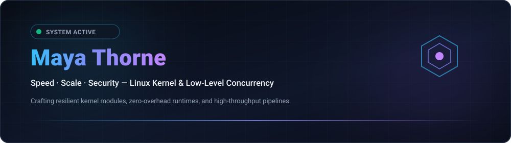



  
  

  <strong>Architecting Resilient Low-Level Systems, Kernel Modules &amp; High-Throughput Concurrency Primitives.</strong> 
  Speed · Scale · Security — Engineering with clarity and conviction. 🚀 ( •̀ᴗ•́ )و

  <a href="../README.md"><strong>🇺🇸 English</strong></a> · <a href="./ko.md">🇰🇷 한국어</a> · <a href="./zh-CN.md">🇨🇳 中文</a> · <a href="./es.md">🇪🇸 Español</a> · <a href="./hi.md">🇮🇳 हिन्दी</a> 
  <a href="./ar.md">🇸🇦 العربية</a> · <a href="./pt-BR.md">🇧🇷 Português</a> · <a href="./ru.md">🇷🇺 Русский</a> · <a href="./fr.md">🇫🇷 Français</a> · <a href="./id.md">🇮🇩 Bahasa Indonesia</a>

  
  
  
  

---

<!-- Quick Jump Navigation Bar -->

  <a href="#about-engineering-ethos"><b>⚡ About</b></a> &nbsp;•&nbsp;
  <a href="#core-systems-architecture"><b>🚀 13 Repos Showcase</b></a> &nbsp;•&nbsp;
  <a href="#featured-capabilities"><b>⚙️ Capabilities</b></a> &nbsp;•&nbsp;
  <a href="#technology-stack"><b>💻 Tech Stack</b></a> &nbsp;•&nbsp;
  <a href="#explore-projects"><b>🗺️ Roadmaps</b></a> &nbsp;•&nbsp;
  <a href="#architecture-dashboard"><b>📊 Metrics</b></a> &nbsp;•&nbsp;
  <a href="#repository-structure"><b>📂 Structure</b></a>

---

<h2 style="display:inline-block; margin:0;">⚡ About &amp; Engineering Ethos</h2>

 

Architecting resilient low-level software systems, Linux kernel modules, and high-throughput concurrency primitives. Engineering centered around mechanical sympathy and zero-overhead performance:

- ⚡ **Zero-Cost &amp; Mechanical Sympathy** — Code engineered to respect CPU cache hierarchies, memory alignment, and branch predictors. Zero-overhead abstractions by default.
- 🐧 **Kernel-First Architecture** — Treating the operating system kernel not as an opaque abstraction, but as the foundational runtime. Deep instrumentation with io_uring, eBPF, and lockless queues.
- 🛡️ **Invariant-Driven Correctness** — Compile-time safety guarantees, deterministic finite-state machine transitions, lock-free ring buffers, and continuous fuzzing validation.

  <em>(⌐■_■) 💻 "In the terminal we trust. Make it deterministic. Automate the friction away."</em>

---

<h2 style="display:inline-block; margin:0;">🚀 Core Systems & Infrastructure Architecture</h2>

 

High-performance distributed runtimes, kernel-bypass networking primitives, and cryptographically verified infrastructure topology engines across 5 core research domains:

### ⚡ Low-Level Systems & Kernel Primitives

<table>
  <tr>
    <td width="50%" valign="top">
      

        
      

      <h4><a href="https://github.com/maya-thorne/ring-io">⚡ ring-io</a></h4>
      
<em>High-Throughput, Zero-Overhead Asynchronous I/O Engine via Linux io_uring (C23).</em>

      

        
        
        
      

      <ul>
        <li>🌀 <strong>Zero-Syscall Ring Queue</strong>: Lock-free submission (SQ) & completion (CQ) ring buffers bypassing epoll/kqueue overhead</li>
        <li>⚡ <strong>Kernel Polling Engine</strong>: Kernel-side SQPOLL worker threads achieving 2.85 Mops/sec batch processing</li>
        <li>🔒 <strong>Deterministic Memory</strong>: Pure C23 architecture, cache-aligned data structures, and zero-allocation runtime</li>
      </ul>
    </td>
    <td width="50%" valign="top">
      

        
      

      <h4><a href="https://github.com/maya-thorne/github-org-map">🗺️ github-org-map</a></h4>
      
<em>Automated daily topology mapping of Linux kernel and concurrency runtime repositories with SHA-256 privacy hashing.</em>

      

        
        
        
      

      <ul>
        <li>🔄 <strong>Continuous Cartography</strong>: Scheduled GitHub Actions workflow auto-mapping kernel research and systems repos</li>
        <li>🛡️ <strong>One-Way Hash Masking</strong>: Salted SHA-256 hashing concealing proprietary kernel exploit labs while preserving lineage</li>
        <li>📊 <strong>Native Vector Telemetry</strong>: Pure zero-dependency SVG 2D coordinate engine with frame-accurate animated timeline generation</li>
      </ul>
    </td>
  </tr>
  <tr>
    <td colspan="2" valign="top">
      

        
      

      <h4><a href="https://github.com/maya-thorne/github-org-map-private">🔒 github-org-map-private</a></h4>
      
<em>Isolated companion telemetry pipeline for low-level kernel modules, exploit defense analysis, and private architectural research.</em>

      

        
        
        
      

      <ul>
        <li>🔐 <strong>Hardware-Bound Vault</strong>: Windows DPAPI encrypted secret encapsulation ensuring hardware-bound credentials security</li>
        <li>⚡ <strong>Deterministic Assertions</strong>: Automated property-based test harness verifying preimage resistance and collision-free mapping</li>
        <li>📜 <strong>Dual Ground-Truth Audit</strong>: Continuous audit pipeline validating public masked artifacts against unmasked internal system graphs</li>
      </ul>
    </td>
  </tr>
</table>

### 🔬 Binary Reverse Engineering & Packers

<table>
  <tr>
    <td width="50%" valign="top">
      

        
      

      <h4><a href="https://github.com/maya-thorne/bat2exe-ghidra-forensics">🔬 bat2exe-ghidra-forensics</a></h4>
      
<em>Ghidra MCP PE binary reverse engineering (UPX/CLR/VB6 Bat2Exe packers), 8 core obfuscator source dissections & multi-pass AST deobfuscation engine.</em>

      

        
        
        
      

      <ul>
        <li>🔬 <strong>Ghidra MCP PE Disassembly</strong>: Deep disassembly of bat2exe_12.exe (UPX 0x20ea0), example.exe (.NET CLR 0x337e), and BEDeCode.exe (VB6 0x1670)</li>
        <li>🛠️ <strong>8 Core Tools Dissection</strong>: Line-by-line source teardowns of BatCloak polyglot, Somalifuscator, 0xidiz3r, Exorcism API hook, and Bat2Exe compilers</li>
        <li>⚡ <strong>Multi-Pass AST Engine</strong>: Automated 6-pass static deobfuscator (src/deobfuscator_engine.py) and Sigma/YARA rulesets</li>
      </ul>
    </td>
    <td width="50%" valign="top">
      

        
      

      <h4><a href="https://github.com/maya-thorne/dotnet-packer-forensics">🔬 dotnet-packer-forensics</a></h4>
      
<em>Static forensic unpacker, CLR metadata analysis, PE overlay carving & dual-XOR research archive for commercial .NET protectors.</em>

      

        
        
        
      

      <ul>
        <li>📑 <strong>PE Overlay Carving</strong>: Pure-Python static detector carving hidden payloads appended past physical PE section boundaries</li>
        <li>🔑 <strong>Dual-XOR Payload Extraction</strong>: Automatic key detection and decoding for xorPacker / xorStub encrypted PE containers</li>
        <li>🔍 <strong>CLR Metadata Analysis</strong>: Zero-execution fingerprinting of ConfuserEx, .NET Reactor, Babel, Eazfuscator, and ArmDot</li>
      </ul>
    </td>
  </tr>
  <tr>
    <td colspan="2" valign="top">
      

        
      

      <h4><a href="https://github.com/maya-thorne/batch-deobfuscator-re">🔬 batch-deobfuscator-re</a></h4>
      
<em>Multi-pass batch deobfuscator engine, Ghidra PE unpacker forensics (UPX/LZMA/XOR overlay) & 48+ open-source reference archive.</em>

      

        
        
        
      

      <ul>
        <li>🌀 <strong>Fixed-Point AST Deobfuscator</strong>: Multi-pass iterative reducer peeling nested variable slicing, caret masking, and token concatenation</li>
        <li>🗜️ <strong>Static PE Container Extractor</strong>: Unpacker for UPX, LZMA, and raw XOR overlays embedded within compiled wrappers</li>
        <li>📚 <strong>Comprehensive Corpus</strong>: Dissection of 7 flagship deobfuscation engines paired with 48+ indexed GitHub/AI reference corpora</li>
      </ul>
    </td>
  </tr>
</table>

### 🛡️ Compiler & AST Obfuscation

<table>
  <tr>
    <td width="50%" valign="top">
      

        
      

      <h4><a href="https://github.com/maya-thorne/batch-obfuscation-research">🛡️ batch-obfuscation-research</a></h4>
      
<em>Windows batch (cmd.exe) obfuscation, deobfuscation & binary reverse engineering master archive (1990s–2026).</em>

      

        
        
        
      

      <ul>
        <li>📜 <strong>30-Year Evolution Archive</strong>: 48+ open-source tool mirrors, Mandiant/Daniel Bohannon research, and Hugging Face AI datasets</li>
        <li>🧠 <strong>cmd.exe 5-Phase Parser</strong>: Comprehensive whitepaper on command line expansion order and pushdown automaton state machines</li>
        <li>🌐 <strong>10-Language Documentation</strong>: Complete localized technical documentation with terminal SVG banners</li>
      </ul>
    </td>
    <td width="50%" valign="top">
      

        
      

      <h4><a href="https://github.com/maya-thorne/dotnet-obfuscation-and-ghidra-re">🛡️ dotnet-obfuscation-and-ghidra-re</a></h4>
      
<em>Blue Team EDR/SIEM detection engineering, 52 Sigma rules, 32 YARA signatures, CIL metadata forensics & Ghidra binary RE suite.</em>

      

        
        
        
      

      <ul>
        <li>🛡️ <strong>dnlib & AntiTamper Forensics</strong>: Detection of JIT method encryption, AntiDump memory wipers, and corrupted #~ table stream headers</li>
        <li>⚙️ <strong>Ghidra CIL Re-Decompilation</strong>: Binary RE workflows uncovering custom native VM dispatch loops and JIT decryptor hooks</li>
        <li>📊 <strong>Enterprise SOC Rulesets</strong>: 52 modular Sigma rules and 32 YARA signatures covering commercial protector evasion techniques</li>
      </ul>
    </td>
  </tr>
  <tr>
    <td colspan="2" valign="top">
      

        
      

      <h4><a href="https://github.com/maya-thorne/cmd-ast-deobfuscator">🛡️ cmd-ast-deobfuscator</a></h4>
      
<em>Multi-pass Abstract Syntax Tree & lexical deobfuscation engine for Windows command scripts (cmd.exe / .bat).</em>

      

        
        
        
      

      <ul>
        <li>🧩 <strong>Multi-Pass Lexical Analyzer</strong>: Pushdown automaton parsing nested caret insertions (^), percent slicing, and exclamation marks</li>
        <li>⚡ <strong>Zero-Execution Normalizer</strong>: Safe in-memory evaluation reconstructing obfuscated batch payloads without dynamic interpreter execution</li>
        <li>🛡️ <strong>Forensic Pipeline</strong>: Direct integration with Ghidra RE findings and detection telemetry signatures</li>
      </ul>
    </td>
  </tr>
</table>

### 🔍 Defensive Detection Engineering

<table>
  <tr>
    <td width="50%" valign="top">
      

        
      

      <h4><a href="https://github.com/maya-thorne/batch-forensics-and-ghidra-re">🛡️ batch-forensics-and-ghidra-re</a></h4>
      
<em>Blue team EDR/SIEM detection engineering, 52 Sigma rules, 32 YARA signatures, entropy & caret density scoring & parser forensics.</em>

      

        
        
        
      

      <ul>
        <li>📐 <strong>Shannon Entropy & Caret Scorer</strong>: Pure-Python static detector (src/entropy_detector.py) calculating caret density and delimiter skew</li>
        <li>🔍 <strong>Sysmon & Event 4688 Coverage</strong>: 52 production Sigma rules mapped to MITRE ATT&CK Defense Evasion, Execution, and Persistence</li>
        <li>🚀 <strong>Defensive AST Simulator</strong>: Zero-execution command unescaper (src/cmd_parser_simulator.py) for automated triage</li>
      </ul>
    </td>
    <td width="50%" valign="top">
      

        
      

      <h4><a href="https://github.com/maya-thorne/chromium-app-spoofing-forensics">🛡️ chromium-app-spoofing-forensics</a></h4>
      
<em>Blue team EDR/SIEM detection engineering, 52 Sigma rules, 32 YARA signatures, [MS-SHLLINK] binary carving & window class auditor.</em>

      

        
        
        
      

      <ul>
        <li>📑 <strong>[MS-SHLLINK] Binary Carving</strong>: Pure-Python parser extracting ShellLinkHeader, ExtraData blocks, and icon location masquerading</li>
        <li>🔍 <strong>Window Class Hierarchy Audit</strong>: Identifies stripped Chrome_WidgetWin_1 windows disguised as native Microsoft Teams/Office</li>
        <li>⚡ <strong>Turnkey SIEM Feeds</strong>: Production Splunk SPL and Elasticsearch KQL query feeds ready for instant SOC deployment</li>
      </ul>
    </td>
  </tr>
</table>

### 🌐 Virtualization, Evasion Forensics & Profile Hub

<table>
  <tr>
    <td width="50%" valign="top">
      

        
      

      <h4><a href="https://github.com/maya-thorne/browser-in-the-browser-virtualization">🌐 browser-in-the-browser-virtualization</a></h4>
      
<em>Client-side DOM virtualization, synthetic Omnibox UI spoofing, draggable physics engine & multi-tier defense heuristics.</em>

      

        
        
        
      

      <ul>
        <li>🪟 <strong>DOM Window Virtualization</strong>: Synthetic OS titlebar, drag physics (mousedown/mousemove), and z-index 9999 stacking model</li>
        <li>🔬 <strong>Static & Heuristic Scanners</strong>: Python static AST analyzer detecting synthetic Omniboxes and CSP frame-ancestors 'none' auditor</li>
        <li>🛡️ <strong>Enterprise Defense Matrix</strong>: Frame-busting traps, MutationObserver DOM guards, and multi-monitor viewport escape detection</li>
      </ul>
    </td>
    <td width="50%" valign="top">
      

        
      

      <h4><a href="https://github.com/maya-thorne">💎 maya-thorne (Profile & Research Hub)</a></h4>
      
<em>Specialized GitHub profile hub, dynamic multi-language cartography architecture (10 locales) & automated telemetry synchronization.</em>

      

        
        
        
      

      <ul>
        <li>🌐 <strong>10-Language Matrix</strong>: Synchronized multi-locale technical profile hubs covering ar, en, es, fr, hi, id, ko, pt-BR, ru, and zh-CN</li>
        <li>📊 <strong>Dynamic Vector Badging</strong>: Hardware-accelerated SVG badging, streak stats, and cryptographic topology integration</li>
        <li>🏛️ <strong>Unified Research Taxonomy</strong>: Cohesive categorization spanning 12 specialized systems, RE, and detection engineering repositories</li>
      </ul>
    </td>
  </tr>
</table>

  <a href="https://github.com/maya-thorne?tab=repositories">Browse Public Repositories</a> ·
  <a href="https://github.com/maya-thorne/github-org-map">Explore Systems Topology</a>

---

<h2 style="display:inline-block; margin:0;">⚙️ Featured Capabilities &amp; Architectures</h2>

 

<table>
  <tr>
    <td width="50%" valign="top">
      <h4>🐧 Kernel &amp; Low-Level Primitives</h4>
      
<em>Asynchronous I/O via io_uring, kernel-bypass networking, and real-time observability.</em>

      <ul>
        <li>🌀 <strong>io_uring &amp; Async I/O</strong>: High-throughput submission/completion ring queues bypassing legacy epoll overhead.</li>
        <li>⚡ <strong>Kernel Bypass &amp; XDP</strong>: Programmable eBPF/XDP fast-path packet filtering and DPDK user-space acceleration.</li>
        <li>🔒 <strong>Lock-Free Primitives</strong>: SPMC/MPSC atomic queues, hazard pointers, and memory barrier synchronization.</li>
      </ul>
    </td>
    <td width="50%" valign="top">
      <h4>🌐 Distributed Systems &amp; Concurrency</h4>
      
<em>Modern CSP-style concurrency pipelines, zero-copy serialization, and memory-safe systems software.</em>

      <ul>
        <li>🛠️ <strong>Systems Tooling</strong>: Idiomatic modern C23, async and unsafe Rust (no_std), and Zig toolchains.</li>
        <li>📦 <strong>Zero-Copy Data Flow</strong>: Cache-aligned serialization over NVMe storage fabrics and high-bandwidth networking.</li>
        <li>🧪 <strong>Invariant Validation</strong>: State automaton verification, property-based testing, and automated fuzzing suites.</li>
      </ul>
    </td>
  </tr>
</table>

---

<h2 style="display:inline-block; margin:0;">💻 Technology Stack &amp; Tooling</h2>

 

<em>Engineering toolchain for high-performance systems and bare-metal runtime execution:</em>

<table>
  <tr>
    <td width="50%" valign="top">
      <h4>⚙️ Low-Level &amp; Systems</h4>
      <ul>
        <li>🔤 <strong>Languages</strong>: C23, Rust (Async / Unsafe / no_std), Zig, x86_64 / ARM64 Assembly</li>
        <li>🐧 <strong>Kernel Runtimes</strong>: Linux Kernel Modules, POSIX APIs, eBPF / XDP, io_uring</li>
        <li>🧠 <strong>Memory &amp; Concurrency</strong>: Lock-free atomics, SIMD vectorization, NUMA-aware allocators</li>
      </ul>
    </td>
    <td width="50%" valign="top">
      <h4>🌐 Distributed &amp; Infrastructure</h4>
      <ul>
        <li>⚡ <strong>Networking</strong>: Kernel-bypass (DPDK), epoll/kqueue, WebSockets, gRPC</li>
        <li>🔍 <strong>Observability</strong>: bpftrace, perf, Valgrind, GDB, Prometheus telemetry</li>
        <li>🖥️ <strong>Environment</strong>: Arch Linux, Debian, Docker, LLVM/Clang toolchains, Neovim / Tmux</li>
      </ul>
    </td>
  </tr>
</table>

 

  

---

<h2 style="display:inline-block; margin:0;">🗺️ Explore Projects &amp; Roadmaps</h2>

 

<strong>Organization Map &amp; Topology</strong>

  

  Private repositories appear only as masked labels. 
  <a href="https://github.com/maya-thorne/github-org-map">Explore Topology &amp; Cartography →</a>

 

<em>Active roadmap and technical initiatives across low-level infrastructure:</em>

<ul>
  <li>🎯 <strong>Current Focus</strong>: io_uring multi-ring polling benchmarks and kernel module fuzzing harness</li>
  <li>🚀 <strong>Next Milestone</strong>: Lock-free SPMC work-stealing scheduler with NUMA cache-pinning</li>
  <li>🔬 <strong>Research Track</strong>: eBPF-driven network flow router with hardware offloading</li>
</ul>

---

<h2 style="display:inline-block; margin:0;">📊 Architecture Dashboard &amp; Delivery Metrics</h2>

 

  

    
    
  

---

<h2 style="display:inline-block; margin:0;">📁 Profile Repository Structure &amp; Directory Map</h2>

 

<table width="100%">
  <thead>
    <tr>
      <th width="30%" align="left"><nobr>📁 Path / Asset</nobr></th>
      <th width="20%" align="left"><nobr>⚙️ Category</nobr></th>
      <th width="50%" align="left"><nobr>📝 Engineering Responsibility</nobr></th>
    </tr>
  </thead>
  <tbody>
    <tr>
      <td><strong><code>assets/projects/</code></strong></td>
      <td>Vector Assets</td>
      <td>High-resolution SVG project banners for all 13 systems research repositories (100% XML valid)</td>
    </tr>
    <tr>
      <td><strong><code>assets/badges/</code></strong></td>
      <td>Visual Telemetry</td>
      <td>Custom vector indicator badges for focus areas, telemetry status, and security specifications</td>
    </tr>
    <tr>
      <td><strong><code>assets/stats/</code></strong></td>
      <td>Metrics Telemetry</td>
      <td>Real-time architecture and contribution telemetry SVG badges</td>
    </tr>
    <tr>
      <td><strong><code>locales/</code></strong></td>
      <td>Internationalization</td>
      <td>10-language global localized profile showcases (<code>ar</code>, <code>en</code>, <code>es</code>, <code>fr</code>, <code>hi</code>, <code>id</code>, <code>ko</code>, <code>pt-BR</code>, <code>ru</code>, <code>zh-CN</code>)</td>
    </tr>
    <tr>
      <td><strong><code>avatar.svg</code></strong></td>
      <td>Branding Asset</td>
      <td>Clean geometric vector monogram of Maya Thorne</td>
    </tr>
    <tr>
      <td><strong><code>hero.svg</code></strong></td>
      <td>Branding Asset</td>
      <td>Responsive widescreen terminal-themed header banner</td>
    </tr>
    <tr>
      <td><strong><code>.gitignore</code></strong></td>
      <td>Security Boundary</td>
      <td>Zero-leak isolation boundary blocking AI memory, credentials, and OS cache artifacts</td>
    </tr>
    <tr>
      <td><strong><code>LICENSE</code></strong></td>
      <td>Legal / License</td>
      <td>Maya Thorne Systems &amp; Security Research License (MT-SRL)</td>
    </tr>
    <tr>
      <td><strong><code>README.md</code></strong></td>
      <td>Master Entrypoint</td>
      <td>Central GitHub profile dashboard featuring 13 research repositories across 5 systems domains</td>
    </tr>
  </tbody>
</table>

---

## 📬 Connect &amp; Collaborate

Interested in discussing low-level systems architectures, Linux kernel internals, or high-performance concurrency primitives? (ง •̀_•́)ง

🐙 [GitHub Profile](https://github.com/maya-thorne) · 📦 [Public Repositories](https://github.com/maya-thorne?tab=repositories) · 💬 [Discussions](https://github.com/maya-thorne?tab=discussions) · ✉️ [Send an Email](mailto:zse4123jo@gmail.com)

   
  © 2026 Maya Thorne · Systems Architecture &amp; Kernel Engineering ( 💻 ˘◡˘ )

