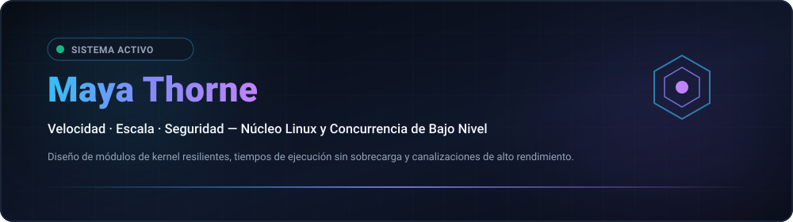

  
  

  <strong>Architecting Resilient Low-Level Systems, Kernel Modules &amp; High-Throughput Concurrency Primitives.</strong> 
  Speed · Scale · Security — Engineering with clarity and conviction. 🚀 ( •̀ᴗ•́ )و

  <a href="../README.md">🇺🇸 English</a> · <a href="./ko.md">🇰🇷 한국어</a> · <a href="./zh-CN.md">🇨🇳 中文</a> · <strong>🇪🇸 Español</strong> · <a href="./hi.md">🇮🇳 हिन्दी</a> 
  <a href="./ar.md">🇸🇦 العربية</a> · <a href="./pt-BR.md">🇧🇷 Português</a> · <a href="./ru.md">🇷🇺 Русский</a> · <a href="./fr.md">🇫🇷 Français</a> · <a href="./id.md">🇮🇩 Bahasa Indonesia</a>

  
  
  
  

---

<!-- Barra de Navegación Rápida -->

  <a href="#about-engineering-ethos"><b>⚡ Acerca de</b></a> &nbsp;•&nbsp;
  <a href="#core-systems-architecture"><b>🚀 13 Repositorios</b></a> &nbsp;•&nbsp;
  <a href="#featured-capabilities"><b>⚙️ Capacidades</b></a> &nbsp;•&nbsp;
  <a href="#technology-stack"><b>💻 Stack Tecnológico</b></a> &nbsp;•&nbsp;
  <a href="#explore-projects"><b>🗺️ Roadmaps</b></a> &nbsp;•&nbsp;
  <a href="#architecture-dashboard"><b>📊 Métricas</b></a> &nbsp;•&nbsp;
  <a href="#repository-structure"><b>📂 Estructura</b></a>

---

<h2 style="display:inline-block; margin:0;">Acerca de &amp; Filosofía de Ingeniería</h2>

 

Arquitectura de sistemas de software de bajo nivel, módulos del kernel de Linux y primitivas de concurrencia de alto rendimiento. Enfoque en simpatía mecánica y cero sobrecarga:

- **Cero Costo &amp; Simpatía Mecánica** — Código diseñado para respetar jerarquías de caché de CPU, alineación de memoria y predictores de saltos.
- 🐧 **Arquitectura Centrada en el Kernel** — Tratando el kernel del sistema operativo como el sustrato de ejecución fundamental con io_uring, eBPF y colas sin bloqueos.
- **Corrección Basada en Invariantes** — Garantías de seguridad en tiempo de compilación, transiciones de autómatas deterministas y pruebas de fuzzing continuo.

  <em>(⌐■_■) 💻 "Confiamos en la terminal. Hazlo determinista. Automatiza la fricción."</em>

---

<h2 style="display:inline-block; margin:0;">🚀 Sistemas Clave y Arquitectura de Infraestructura</h2>

 

Runtimes distribuidos de alto rendimiento, primitivas de red kernel-bypass y motores de topología de infraestructura verificados criptográficamente en 5 dominios de investigación:

### ⚡ Sistemas de Bajo Nivel y Primitivas del Kernel

<table>
  <tr>
    <td width="50%" valign="top">
      

        
      

      <h4><a href="https://github.com/maya-thorne/ring-io">⚡ ring-io</a></h4>
      
<em>Motor de E/S asíncrono de alto rendimiento y sobrecarga cero mediante Linux io_uring (C23).</em>

      

        
        
        
      

      <ul>
        <li>🌀 <strong>Cola Circular Sin Syscalls</strong>: Búferes circulares de envío (SQ) y finalización (CQ) sin bloqueos</li>
        <li>⚡ <strong>Motor de Sondeo del Kernel</strong>: Hilos SQPOLL en espacio de kernel alcanzando 2.85 Mops/sec en procesamiento por lotes</li>
        <li>🔒 <strong>Memoria Determinista</strong>: Arquitectura pura en C23, estructuras alineadas con la caché y ejecución sin asignaciones</li>
      </ul>
    </td>
    <td width="50%" valign="top">
      

        
      

      <h4><a href="https://github.com/maya-thorne/github-org-map">🗺️ github-org-map</a></h4>
      
<em>Mapeo topológico diario automatizado de repositorios del kernel de Linux con hash de privacidad SHA-256.</em>

      

        
        
        
      

      <ul>
        <li>🔄 <strong>Cartografía Continua</strong>: Flujo programado de GitHub Actions que mapea repositorios de investigación de sistemas</li>
        <li>🛡️ <strong>Enmascaramiento Hash</strong>: SHA-256 con sal para proteger laboratorios privados preservando su linaje</li>
        <li>📊 <strong>Telemetría Vectorial Nativa</strong>: Motor SVG 2D sin dependencias con generación de línea temporal animada</li>
      </ul>
    </td>
  </tr>
  <tr>
    <td colspan="2" valign="top">
      

        
      

      <h4><a href="https://github.com/maya-thorne/github-org-map-private">🔒 github-org-map-private</a></h4>
      
<em>Canal de telemetría complementario aislado para módulos del kernel y análisis de defensa contra exploits.</em>

      

        
        
        
      

      <ul>
        <li>🔐 <strong>Bóveda Vinculada al Hardware</strong>: Encapsulación cifrada con Windows DPAPI para credenciales seguras</li>
        <li>⚡ <strong>Aserciones Deterministas</strong>: Conjunto de pruebas automatizadas que verifican resistencia a preimagen</li>
        <li>📜 <strong>Auditoría de Doble Verdad</strong>: Pipeline continuo que valida artefactos públicos frente al grafo interno</li>
      </ul>
    </td>
  </tr>
</table>

### 🔬 Ingeniería Inversa de Binarios y Empaquetadores

<table>
  <tr>
    <td width="50%" valign="top">
      

        
      

      <h4><a href="https://github.com/maya-thorne/bat2exe-ghidra-forensics">🔬 bat2exe-ghidra-forensics</a></h4>
      
<em>Ingeniería inversa de binarios PE con Ghidra MCP (packers Bat2Exe UPX/CLR/VB6), disección de 8 ofuscadores y motor AST.</em>

      

        
        
        
      

      <ul>
        <li>🔬 <strong>Desensamblado PE en Ghidra</strong>: Análisis profundo de binarios empaquetados en UPX, .NET CLR y Visual Basic 6</li>
        <li>🛠️ <strong>Disección de 8 Herramientas</strong>: Análisis línea por línea de BatCloak polyglot, Somalifuscator, 0xidiz3r y hooks de Exorcism</li>
        <li>⚡ <strong>Motor AST Multipaso</strong>: Desofuscador estático de 6 pasos (src/deobfuscator_engine.py) y reglas Sigma/YARA</li>
      </ul>
    </td>
    <td width="50%" valign="top">
      

        
      

      <h4><a href="https://github.com/maya-thorne/dotnet-packer-forensics">🔬 dotnet-packer-forensics</a></h4>
      
<em>Desempaquetador forense estático sin ejecución, análisis de metadatos CLR, carving de overlay PE y archivo de investigación dual-XOR.</em>

      

        
        
        
      

      <ul>
        <li>📑 <strong>Carving de Overlays PE</strong>: Detector en Python que extrae cargas útiles ocultas tras las secciones físicas del PE</li>
        <li>🔑 <strong>Extracción Dual-XOR</strong>: Detección automática de claves y decodificación para contenedores xorPacker / xorStub</li>
        <li>🔍 <strong>Análisis de Metadatos CLR</strong>: Huellas digitales sin ejecución de ConfuserEx, .NET Reactor, Babel y ArmDot</li>
      </ul>
    </td>
  </tr>
  <tr>
    <td colspan="2" valign="top">
      

        
      

      <h4><a href="https://github.com/maya-thorne/batch-deobfuscator-re">🔬 batch-deobfuscator-re</a></h4>
      
<em>Motor de desofuscación de batch multipaso, análisis forense de desempaquetador PE Ghidra y archivo de 48+ referencias.</em>

      

        
        
        
      

      <ul>
        <li>🌀 <strong>Desofuscador AST Punto Fijo</strong>: Reductor iterativo que elimina el corte de variables y el enmascaramiento con carets</li>
        <li>🗜️ <strong>Extractor Estático de PE</strong>: Desempaquetador para capas UPX, LZMA y XOR incrustadas en ejecutables compilados</li>
        <li>📚 <strong>Corpus Integral</strong>: Disección de 7 motores insignia combinada con 48+ repositorios de referencia abiertos e IA</li>
      </ul>
    </td>
  </tr>
</table>

### 🛡️ Ofuscación de Compiladores y AST

<table>
  <tr>
    <td width="50%" valign="top">
      

        
      

      <h4><a href="https://github.com/maya-thorne/batch-obfuscation-research">🛡️ batch-obfuscation-research</a></h4>
      
<em>Archivo maestro de 30 años de investigación sobre ofuscación, desofuscación e ingeniería inversa de batch en Windows (1990s–2026).</em>

      

        
        
        
      

      <ul>
        <li>📜 <strong>Archivo de Evolución de 30 Años</strong>: 48+ espejos de herramientas abiertas, análisis de Mandiant y conjuntos de datos de IA</li>
        <li>🧠 <strong>Parser en 5 Fases de cmd.exe</strong>: Libro blanco exhaustivo sobre el orden de expansión y autómatas de pila</li>
        <li>🌐 <strong>Documentación en 10 Idiomas</strong>: Soporte técnico totalmente localizado con banners terminales en formato SVG</li>
      </ul>
    </td>
    <td width="50%" valign="top">
      

        
      

      <h4><a href="https://github.com/maya-thorne/dotnet-obfuscation-and-ghidra-re">🛡️ dotnet-obfuscation-and-ghidra-re</a></h4>
      
<em>Ingeniería de detección EDR/SIEM para Blue Team, 52 reglas Sigma, 32 firmas YARA, forense CIL y suite RE Ghidra.</em>

      

        
        
        
      

      <ul>
        <li>🛡️ <strong>Forense de dnlib y AntiTamper</strong>: Detección estática de cifrado de métodos JIT, limpiadores AntiDump y flujos #~ corruptos</li>
        <li>⚙️ <strong>Re-descompilación CIL en Ghidra</strong>: Flujos de ingeniería inversa que revelan bucles de despacho en VM nativas</li>
        <li>📊 <strong>Conjuntos de Reglas para SOC</strong>: 52 reglas modulares Sigma y 32 firmas YARA que cubren evasiones comerciales</li>
      </ul>
    </td>
  </tr>
  <tr>
    <td colspan="2" valign="top">
      

        
      

      <h4><a href="https://github.com/maya-thorne/cmd-ast-deobfuscator">🛡️ cmd-ast-deobfuscator</a></h4>
      
<em>Motor de desofuscación léxica y de Árbol de Sintaxis Abstracta (AST) multipaso para scripts de Windows (cmd.exe / .bat).</em>

      

        
        
        
      

      <ul>
        <li>🧩 <strong>Analizador Léxico Multipaso</strong>: Autómata de pila que procesa inserciones de carets (^), cortes de variables y signos de exclamación</li>
        <li>⚡ <strong>Normalizador Seguro Sin Ejecución</strong>: Evaluación segura en memoria que reconstruye scripts ofuscados sin ejecutarlos</li>
        <li>🛡️ <strong>Pipeline Forense</strong>: Integración directa con los hallazgos de Ghidra RE y firmas de telemetría de detección</li>
      </ul>
    </td>
  </tr>
</table>

### 🔍 Ingeniería de Detección Defensiva y Análisis Forense

<table>
  <tr>
    <td width="50%" valign="top">
      

        
      

      <h4><a href="https://github.com/maya-thorne/batch-forensics-and-ghidra-re">🛡️ batch-forensics-and-ghidra-re</a></h4>
      
<em>Ingeniería de detección EDR/SIEM para Blue Team, 52 reglas Sigma, 32 firmas YARA, puntuación de entropía y forense de parser.</em>

      

        
        
        
      

      <ul>
        <li>📐 <strong>Puntuador de Entropía y Carets</strong>: Detector en Python (src/entropy_detector.py) que calcula densidad y sesgo de delimitadores</li>
        <li>🔍 <strong>Cobertura Sysmon y Evento 4688</strong>: 52 reglas Sigma mapeadas a tácticas de Evasión de Defensa, Ejecución y Persistencia</li>
        <li>🚀 <strong>Simulador AST Defensivo</strong>: Normalizador de comandos en memoria (src/cmd_parser_simulator.py) para triaje automático</li>
      </ul>
    </td>
    <td width="50%" valign="top">
      

        
      

      <h4><a href="https://github.com/maya-thorne/chromium-app-spoofing-forensics">🛡️ chromium-app-spoofing-forensics</a></h4>
      
<em>Ingeniería de detección EDR/SIEM, 52 reglas Sigma, 32 firmas YARA, carving binario [MS-SHLLINK] y auditoría de clases de ventana.</em>

      

        
        
        
      

      <ul>
        <li>📑 <strong>Carving Binario [MS-SHLLINK]</strong>: Parser en Python que extrae bloques ShellLinkHeader y suplantación de iconos</li>
        <li>🔍 <strong>Auditoría de Clases de Ventana</strong>: Identifica ventanas Chrome_WidgetWin_1 camufladas como Microsoft Teams u Office</li>
        <li>⚡ <strong>Feeds SIEM Listos para Usar</strong>: Consultas de producción en Splunk SPL y Elastic KQL listas para el SOC</li>
      </ul>
    </td>
  </tr>
</table>

### 🌐 Virtualización, Análisis Forense de Evasión y Perfil Hub

<table>
  <tr>
    <td width="50%" valign="top">
      

        
      

      <h4><a href="https://github.com/maya-thorne/browser-in-the-browser-virtualization">🌐 browser-in-the-browser-virtualization</a></h4>
      
<em>Virtualización DOM del lado del cliente, suplantación de UI de Omnibox sintética, motor de física y heurística de defensa.</em>

      

        
        
        
      

      <ul>
        <li>🪟 <strong>Virtualización de Ventana DOM</strong>: Barra de título simulada, física de arrastre y modelo de capas z-index 9999</li>
        <li>🔬 <strong>Escáneres Estáticos y Heurísticos</strong>: Analizador Python AST que detecta Omniboxes sintéticos y audita CSP</li>
        <li>🛡️ <strong>Matriz de Defensa Empresarial</strong>: Trampas anti-marcos, vigilantes MutationObserver y detección de escape en multi-monitor</li>
      </ul>
    </td>
    <td width="50%" valign="top">
      

        
      

      <h4><a href="https://github.com/maya-thorne">💎 maya-thorne (Hub de Perfil e Investigación)</a></h4>
      
<em>Repositorio de perfil especial de GitHub, arquitectura de cartografía multilingüe dinámica (10 idiomas) y sincronización de telemetría.</em>

      

        
        
        
      

      <ul>
        <li>🌐 <strong>Matriz en 10 Idiomas</strong>: Hubs técnicos sincronizados en árabe, inglés, español, francés, hindi, indonesio, coreano, portugués, ruso y chino</li>
        <li>📊 <strong>Badging Vectorial Dinámico</strong>: Insignias SVG, estadísticas de racha e integración de topología criptográfica</li>
        <li>🏛️ <strong>Taxonomía Unificada de Investigación</strong>: Categorización integral que abarca 12 repositorios de sistemas, RE y defensa</li>
      </ul>
    </td>
  </tr>
</table>

  <a href="https://github.com/maya-thorne?tab=repositories">Explorar Repositorios Públicos</a> ·
  <a href="https://github.com/maya-thorne/github-org-map">Explorar Topología de Sistemas</a>

---

<h2 style="display:inline-block; margin:0;">Capacidades &amp; Arquitecturas Destacadas</h2>

 

<table>
  <tr>
    <td width="50%" valign="top">
      <h4>Primitivas de Kernel &amp; Bajo Nivel</h4>
      
<em>E/S asíncrona mediante io_uring, redes con kernel-bypass y observabilidad en tiempo real.</em>

      <ul>
        <li>🌀 <strong>io_uring &amp; E/S Asíncrona</strong>: Colas circulares de envío/finalización de alto rendimiento sin sobrecarga de epoll.</li>
        <li>⚡ <strong>Kernel Bypass &amp; XDP</strong>: Filtrado programable de paquetes eBPF/XDP y aceleración en espacio de usuario con DPDK.</li>
        <li><strong>Primitivas Sin Bloqueos</strong>: Colas atómicas SPMC/MPSC, hazard pointers y barreras de memoria.</li>
      </ul>
    </td>
    <td width="50%" valign="top">
      <h4>Sistemas Distribuidos &amp; Concurrencia</h4>
      
<em>Pipelines de concurrencia estilo CSP, serialización sin copias y software seguro en memoria.</em>

      <ul>
        <li>🛠️ <strong>Herramientas de Sistemas</strong>: C23 moderno, Rust asíncrono e inseguro (no_std) y toolchains de Zig.</li>
        <li><strong>Flujo de Datos Sin Copias</strong>: Serialización alineada en caché sobre almacenamiento NVMe y redes de alto ancho de banda.</li>
        <li>🧪 <strong>Validación de Invariantes</strong>: Verificación de autómatas de estado, pruebas basadas en propiedades y suites de fuzzing.</li>
      </ul>
    </td>
  </tr>
</table>

---

<h2 style="display:inline-block; margin:0;">Stack Tecnológico &amp; Herramientas</h2>

 

<em>Cadena de herramientas de ingeniería para sistemas de alto rendimiento y ejecución en bare-metal:</em>

<table>
  <tr>
    <td width="50%" valign="top">
      <h4>Bajo Nivel &amp; Sistemas</h4>
      <ul>
        <li>🔤 <strong>Lenguajes</strong>: C23, Rust (Async / Unsafe / no_std), Zig, Ensamblador x86_64 / ARM64</li>
        <li><strong>Runtimes de Kernel</strong>: Módulos de Linux Kernel, APIs POSIX, eBPF / XDP, io_uring</li>
        <li><strong>Memoria &amp; Concurrencia</strong>: Atómicos sin bloqueos, vectorización SIMD, asignadores NUMA</li>
      </ul>
    </td>
    <td width="50%" valign="top">
      <h4>Distribuido &amp; Infraestructura</h4>
      <ul>
        <li>⚡ <strong>Redes</strong>: Kernel-bypass (DPDK), epoll/kqueue, WebSockets, gRPC</li>
        <li>🔍 <strong>Observabilidad</strong>: bpftrace, perf, Valgrind, GDB, telemetría Prometheus</li>
        <li>🖥️ <strong>Entorno</strong>: Arch Linux, Debian, Docker, LLVM/Clang, Neovim / Tmux</li>
      </ul>
    </td>
  </tr>
</table>

 

  

---

<h2 style="display:inline-block; margin:0;">Explorar Proyectos &amp; Roadmaps</h2>

 

<strong>Mapa de Organización &amp; Topología</strong>

  

  Los repositorios privados aparecen solo como etiquetas enmascaradas. 
  <a href="https://github.com/maya-thorne/github-org-map">Explorar Topología &amp; Cartografía →</a>

 

<em>Iniciativas técnicas y hoja de ruta activa en infraestructura de bajo nivel:</em>

<ul>
  <li>🎯 <strong>Enfoque Actual</strong>: Benchmarks de sondeo multi-anillo io_uring y harness de fuzzing para módulos del kernel</li>
  <li>🚀 <strong>Próximo Hito</strong>: Planificador work-stealing SPMC sin bloqueos con fijación de memoria NUMA</li>
  <li>🔬 <strong>Línea de Investigación</strong>: Enrutador de flujos de red con eBPF y aceleración por hardware</li>
</ul>

---

<h2 style="display:inline-block; margin:0;">Dashboard de Arquitectura &amp; Métricas</h2>

 

  

    
    
  

---

<h2 style="display:inline-block; margin:0;">📁 Estructura del Repositorio y Mapa de Directorios</h2>

 

<table width="100%">
  <thead>
    <tr>
      <th width="30%" align="left"><nobr>📁 Ruta / Activo</nobr></th>
      <th width="20%" align="left"><nobr>⚙️ Categoría</nobr></th>
      <th width="50%" align="left"><nobr>📝 Responsabilidad de Ingeniería</nobr></th>
    </tr>
  </thead>
  <tbody>
    <tr>
      <td><strong><code>assets/projects/</code></strong></td>
      <td>Activos Vectoriales</td>
      <td>Banners SVG de alta resolución para los 13 repositorios de investigación de sistemas (100% XML válido)</td>
    </tr>
    <tr>
      <td><strong><code>assets/badges/</code></strong></td>
      <td>Telemetría Visual</td>
      <td>Insignias vectoriales personalizadas para áreas de enfoque, estado de telemetría y especificaciones de seguridad</td>
    </tr>
    <tr>
      <td><strong><code>assets/stats/</code></strong></td>
      <td>Telemetría de Métricas</td>
      <td>Insignias SVG de telemetría de arquitectura y contribuciones en tiempo real</td>
    </tr>
    <tr>
      <td><strong><code>locales/</code></strong></td>
      <td>Internacionalización</td>
      <td>Showcases de perfil global localizados en 10 idiomas (<code>ar</code>, <code>en</code>, <code>es</code>, <code>fr</code>, <code>hi</code>, <code>id</code>, <code>ko</code>, <code>pt-BR</code>, <code>ru</code>, <code>zh-CN</code>)</td>
    </tr>
    <tr>
      <td><strong><code>avatar.svg</code></strong></td>
      <td>Activo de Marca</td>
      <td>Monograma vectorial geométrico de Maya Thorne</td>
    </tr>
    <tr>
      <td><strong><code>hero.svg</code></strong></td>
      <td>Activo de Marca</td>
      <td>Banner de cabecera panorámico y responsivo con estética de terminal</td>
    </tr>
    <tr>
      <td><strong><code>.gitignore</code></strong></td>
      <td>Límite de Seguridad</td>
      <td>Frontera de aislamiento con cero fugas que bloquea memorias de IA, credenciales y artefactos de caché del SO</td>
    </tr>
    <tr>
      <td><strong><code>LICENSE</code></strong></td>
      <td>Legal / Licencia</td>
      <td>Maya Thorne Systems &amp; Security Research License (MT-SRL)</td>
    </tr>
    <tr>
      <td><strong><code>README.md</code></strong></td>
      <td>Punto de Entrada Principal</td>
      <td>Panel central de perfil de GitHub que presenta 13 repositorios de investigación en 5 dominios de sistemas</td>
    </tr>
  </tbody>
</table>

---

## Contacto &amp; Colaboración

¿Interesado en discutir arquitecturas de sistemas de bajo nivel, aspectos internos del kernel de Linux o primitivas de concurrencia?

🐙 [Perfil de GitHub](https://github.com/maya-thorne) · 📦 [Repositorios Públicos](https://github.com/maya-thorne?tab=repositories) · 💬 [Discusiones](https://github.com/maya-thorne?tab=discussions) · ✉️ [Enviar Correo](mailto:zse4123jo@gmail.com)

   
  © 2026 Maya Thorne · Arquitectura de Sistemas e Ingeniería de Kernel ( 💻 ˘◡˘ )

