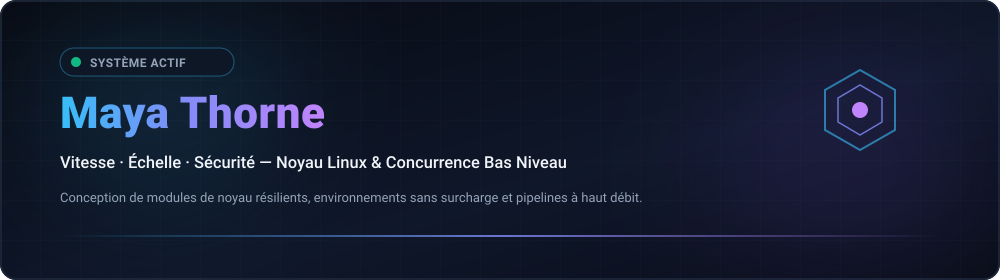

  
  

  <strong>Architecting Resilient Low-Level Systems, Kernel Modules &amp; High-Throughput Concurrency Primitives.</strong> 
  Speed · Scale · Security — Engineering with clarity and conviction. 🚀 ( •̀ᴗ•́ )و

  <a href="../README.md">🇺🇸 English</a> · <a href="./ko.md">🇰🇷 한국어</a> · <a href="./zh-CN.md">🇨🇳 中文</a> · <a href="./es.md">🇪🇸 Español</a> · <a href="./hi.md">🇮🇳 हिन्दी</a> 
  <a href="./ar.md">🇸🇦 العربية</a> · <a href="./pt-BR.md">🇧🇷 Português</a> · <a href="./ru.md">🇷🇺 Русский</a> · <strong>🇫🇷 Français</strong> · <a href="./id.md">🇮🇩 Bahasa Indonesia</a>

  
  
  
  

---

<!-- Barre de Navigation Rapide -->

  <a href="#about-engineering-ethos"><b>⚡ À propos</b></a> &nbsp;•&nbsp;
  <a href="#core-systems-architecture"><b>🚀 Vitrine des 13 Dépôts</b></a> &nbsp;•&nbsp;
  <a href="#featured-capabilities"><b>⚙️ Capacités</b></a> &nbsp;•&nbsp;
  <a href="#technology-stack"><b>💻 Stack Technique</b></a> &nbsp;•&nbsp;
  <a href="#explore-projects"><b>🗺️ Feuilles de Route</b></a> &nbsp;•&nbsp;
  <a href="#architecture-dashboard"><b>📊 Métriques</b></a> &nbsp;•&nbsp;
  <a href="#repository-structure"><b>📂 Structure</b></a>

---

<h2 style="display:inline-block; margin:0;">⚡ About &amp; Engineering Ethos</h2>

 

Architecting resilient low-level software systems, Linux kernel modules, and high-throughput concurrency primitives. Engineering centered around mechanical sympathy and zero-overhead performance:

- ⚡ **Zero-Cost &amp; Mechanical Sympathy** — Code engineered to respect CPU cache hierarchies, memory alignment, and branch predictors. Zero-overhead abstractions by default.
- 🐧 **Kernel-First Architecture** — Treating the operating system kernel not as an opaque abstraction, but as the foundational runtime. Deep instrumentation with io_uring, eBPF, and lockless queues.
- 🛡️ **Invariant-Driven Correctness** — Compile-time safety guarantees, deterministic finite-state machine transitions, lock-free ring buffers, and continuous fuzzing validation.

  <em>(⌐■_■) 💻 "In the terminal we trust. Make it deterministic. Automate the friction away."</em>

---

<h2 style="display:inline-block; margin:0;">🚀 Core Systems & Infrastructure Architecture</h2>

 

Runtimes distribués haute performance, primitives réseau avec contournement du noyau et moteurs de topologie d'infrastructure cryptographiquement vérifiés sur 5 domaines de recherche clés :

### ⚡ Systèmes Bas Niveau & Primitives du Noyau

<table>
  <tr>
    <td width="50%" valign="top">
      

        
      

      <h4><a href="https://github.com/maya-thorne/ring-io">⚡ ring-io</a></h4>
      
<em>Moteur d'E/S asynchrones ultra-performant et sans surcharge via Linux io_uring (C23).</em>

      

        
        
        
      

      <ul>
        <li>🌀 <strong>File Circulaire Sans Appel Système</strong>: Anneaux SQ et CQ sans verrouillage éliminant le coût d'epoll/kqueue</li>
        <li>⚡ <strong>Moteur de Polling Noyau</strong>: Threads SQPOLL côté noyau atteignant 2.85 Mops/sec en traitement par lots</li>
        <li>🔒 <strong>Mémoire Déterministe</strong>: Architecture C23 pure, alignement strict sur les lignes de cache et zéro allocation</li>
      </ul>
    </td>
    <td width="50%" valign="top">
      

        
      

      <h4><a href="https://github.com/maya-thorne/github-org-map">🗺️ github-org-map</a></h4>
      
<em>Cartographie topologique quotidienne automatisée des dépôts de noyau Linux avec hachage SHA-256 préservant la confidentialité.</em>

      

        
        
        
      

      <ul>
        <li>🔄 <strong>Cartographie Continue</strong>: Workflow GitHub Actions planifié cartographiant les dépôts de recherche noyau</li>
        <li>🛡️ <strong>Masquage par Hachage Unidirectionnel</strong>: Hachage SHA-256 salé protégeant les dépôts sensibles d'exploitation</li>
        <li>📊 <strong>Télémétrie Vectorielle Native</strong>: Moteur de coordonnées SVG 2D sans dépendance avec génération de chronologie animée</li>
      </ul>
    </td>
  </tr>
  <tr>
    <td colspan="2" valign="top">
      

        
      

      <h4><a href="https://github.com/maya-thorne/github-org-map-private">🔒 github-org-map-private</a></h4>
      
<em>Pipeline de télémétrie compagnon isolé pour modules noyau, analyse de défense contre les exploits et recherche d'architecture privée.</em>

      

        
        
        
      

      <ul>
        <li>🔐 <strong>Coffre Lié au Matériel</strong>: Encapsulation chiffrée Windows DPAPI garantissant la sécurité des clés d'accès</li>
        <li>⚡ <strong>Assertions Déterministes</strong>: Banc de tests automatisé vérifiant la résistance aux préimages et l'absence de collision</li>
        <li>📜 <strong>Audit Double Vérité</strong>: Pipeline d'audit continu validant les artefacts publics masqués face au graphe interne</li>
      </ul>
    </td>
  </tr>
</table>

### 🔬 Rétro-ingénierie Binaire & Analyse de Packers

<table>
  <tr>
    <td width="50%" valign="top">
      

        
      

      <h4><a href="https://github.com/maya-thorne/bat2exe-ghidra-forensics">🔬 bat2exe-ghidra-forensics</a></h4>
      
<em>Rétro-ingénierie binaire PE Ghidra MCP (packers Bat2Exe UPX/CLR/VB6), dissection du code source de 8 obfuscateurs et moteur AST.</em>

      

        
        
        
      

      <ul>
        <li>🔬 <strong>Désassemblage PE Ghidra MCP</strong>: Analyse poussée des binaires empaquetés UPX, .NET CLR et VB6</li>
        <li>🛠️ <strong>Dissection de 8 Outils Clés</strong>: Déconstruction ligne par ligne de BatCloak polyglotte, Somalifuscator, 0xidiz3r et Exorcism</li>
        <li>⚡ <strong>Moteur AST Multi-Passes</strong>: Désobscurcisseur statique en 6 étapes (src/deobfuscator_engine.py) et règles Sigma/YARA</li>
      </ul>
    </td>
    <td width="50%" valign="top">
      

        
      

      <h4><a href="https://github.com/maya-thorne/dotnet-packer-forensics">🔬 dotnet-packer-forensics</a></h4>
      
<em>Décompresseur forensique statique sans exécution, analyse des métadonnées CLR, extraction d'overlay PE et recherche double-XOR.</em>

      

        
        
        
      

      <ul>
        <li>📑 <strong>Extraction d'Overlays PE</strong>: Détecteur Python pur extrayant les charges utiles masquées au-delà des sections PE</li>
        <li>🔑 <strong>Extraction Double-XOR</strong>: Détection automatique de clés et décodage de conteneurs chiffrés xorPacker / xorStub</li>
        <li>🔍 <strong>Analyse des Métadonnées CLR</strong>: Empreinte sans exécution de ConfuserEx, .NET Reactor, Babel et ArmDot</li>
      </ul>
    </td>
  </tr>
  <tr>
    <td colspan="2" valign="top">
      

        
      

      <h4><a href="https://github.com/maya-thorne/batch-deobfuscator-re">🔬 batch-deobfuscator-re</a></h4>
      
<em>Moteur de désobscuration de scripts batch multi-passes, analyse forensique de packers PE Ghidra et archive de 48+ références.</em>

      

        
        
        
      

      <ul>
        <li>🌀 <strong>Désobscurcisseur AST à Point Fixe</strong>: Réducteur itératif éliminant le découpage de variables et le masquage par accents circonflexes</li>
        <li>🗜️ <strong>Extracteur Statique de Conteneurs PE</strong>: Décompresseur pour wrappers compilés avec overlays UPX, LZMA et XOR</li>
        <li>📚 <strong>Corpus Exhaustif</strong>: Dissection de 7 moteurs phares associée à plus de 48 dépôts de référence open-source et IA</li>
      </ul>
    </td>
  </tr>
</table>

### 🛡️ Obfuscation de Compilateurs & AST

<table>
  <tr>
    <td width="50%" valign="top">
      

        
      

      <h4><a href="https://github.com/maya-thorne/batch-obfuscation-research">🛡️ batch-obfuscation-research</a></h4>
      
<em>Archive maîtresse de 30 ans de recherche sur l'obfuscation, la désobscuration et la rétro-ingénierie de batch Windows (1990–2026).</em>

      

        
        
        
      

      <ul>
        <li>📜 <strong>30 Ans d'Évolution</strong>: Plus de 48 miroirs d'outils open-source, recherches Mandiant et jeux de données IA Hugging Face</li>
        <li>🧠 <strong>Parseur cmd.exe en 5 Phases</strong>: Livre blanc exhaustif sur l'ordre d'expansion et les automates à pile</li>
        <li>🌐 <strong>Documentation en 10 Langues</strong>: Documentation technique entièrement localisée avec bannières SVG style terminal</li>
      </ul>
    </td>
    <td width="50%" valign="top">
      

        
      

      <h4><a href="https://github.com/maya-thorne/dotnet-obfuscation-and-ghidra-re">🛡️ dotnet-obfuscation-and-ghidra-re</a></h4>
      
<em>Ingénierie de détection EDR/SIEM Blue Team, 52 règles Sigma, 32 signatures YARA, analyse CIL et suite RE Ghidra.</em>

      

        
        
        
      

      <ul>
        <li>🛡️ <strong>Forensique dnlib & AntiTamper</strong>: Détection statique du chiffrement de méthodes JIT, nettoyeurs AntiDump et flux #~ altérés</li>
        <li>⚙️ <strong>Re-décompilation CIL dans Ghidra</strong>: Workflows révélant les boucles de dispatch de machines virtuelles natives</li>
        <li>📊 <strong>Règles Clé en Main pour SOC</strong>: 52 règles modulaires Sigma et 32 signatures YARA couvrant les évasions commerciales</li>
      </ul>
    </td>
  </tr>
  <tr>
    <td colspan="2" valign="top">
      

        
      

      <h4><a href="https://github.com/maya-thorne/cmd-ast-deobfuscator">🛡️ cmd-ast-deobfuscator</a></h4>
      
<em>Moteur de désobscuration lexicale et d'arbre syntaxique abstrait (AST) multi-passes pour scripts de commandes Windows (cmd.exe / .bat).</em>

      

        
        
        
      

      <ul>
        <li>🧩 <strong>Analyseur Lexical Multi-Passes</strong>: Automate à pile analysant l'insertion d'accents circonflexes (^), le découpage de variables et !</li>
        <li>⚡ <strong>Normaliseur Sécurisé Sans Exécution</strong>: Évaluation en mémoire reconstruisant les charges utiles sans exécution dynamique</li>
        <li>🛡️ <strong>Pipeline Forensique</strong>: Intégration directe avec les résultats Ghidra RE et les signatures de télémétrie</li>
      </ul>
    </td>
  </tr>
</table>

### 🔍 Ingénierie de Détection Défensive & Forensique

<table>
  <tr>
    <td width="50%" valign="top">
      

        
      

      <h4><a href="https://github.com/maya-thorne/batch-forensics-and-ghidra-re">🛡️ batch-forensics-and-ghidra-re</a></h4>
      
<em>Ingénierie de détection EDR/SIEM Blue Team, 52 règles Sigma, 32 signatures YARA, score d'entropie de Shannon et forensique de parseur.</em>

      

        
        
        
      

      <ul>
        <li>📐 <strong>Score d'Entropie de Shannon & Densité</strong>: Détecteur Python pur (src/entropy_detector.py) évaluant la densité de caractères d'échappement</li>
        <li>🔍 <strong>Couverture Sysmon & Événement 4688</strong>: 52 règles de production Sigma alignées sur les tactiques d'évasion MITRE ATT&CK</li>
        <li>🚀 <strong>Simulateur AST Défensif</strong>: Déséchappement de commandes en mémoire (src/cmd_parser_simulator.py) pour le triage SOC</li>
      </ul>
    </td>
    <td width="50%" valign="top">
      

        
      

      <h4><a href="https://github.com/maya-thorne/chromium-app-spoofing-forensics">🛡️ chromium-app-spoofing-forensics</a></h4>
      
<em>Ingénierie de détection EDR/SIEM, 52 règles Sigma, 32 signatures YARA, analyse binaire [MS-SHLLINK] et audit de classes de fenêtres.</em>

      

        
        
        
      

      <ul>
        <li>📑 <strong>Extraction Binaire [MS-SHLLINK]</strong>: Parseur Python pur extrayant ShellLinkHeader et usurpation d'icônes</li>
        <li>🔍 <strong>Audit de Classes de Fenêtres</strong>: Détection de fenêtres Chrome_WidgetWin_1 camouflées en applications Teams ou Office</li>
        <li>⚡ <strong>Flux SIEM Clé en Main</strong>: Requêtes de production Splunk SPL et Elastic KQL prêtes pour le déploiement SOC</li>
      </ul>
    </td>
  </tr>
</table>

### 🌐 Virtualisation, Analyse Forensique d'Évasion & Hub de Profil

<table>
  <tr>
    <td width="50%" valign="top">
      

        
      

      <h4><a href="https://github.com/maya-thorne/browser-in-the-browser-virtualization">🌐 browser-in-the-browser-virtualization</a></h4>
      
<em>Virtualisation DOM côté client, usurpation d'Omnibox synthétique, moteur physique de glisser-déposer et matrice de défense.</em>

      

        
        
        
      

      <ul>
        <li>🪟 <strong>Virtualisation de Fenêtre DOM</strong>: Barre de titre d'OS synthétique, physique de glisser-déposer et empilement z-index 9999</li>
        <li>🔬 <strong>Scanners Statiques & Heuristiques</strong>: Analyseur AST Python identifiant les fausses Omniboxes et auditeur de règles CSP</li>
        <li>🛡️ <strong>Matrice de Défense Entreprise</strong>: Pièges anti-encadrement, gardes MutationObserver DOM et détection d'échappement multi-écrans</li>
      </ul>
    </td>
    <td width="50%" valign="top">
      

        
      

      <h4><a href="https://github.com/maya-thorne">💎 maya-thorne (Hub de Profil & Recherche)</a></h4>
      
<em>Dépôt de profil GitHub spécialisé, architecture de cartographie multilingue dynamique (10 langues) et synchronisation de télémétrie.</em>

      

        
        
        
      

      <ul>
        <li>🌐 <strong>Matrice en 10 Langues</strong>: Profils techniques synchronisés couvrant ar, en, es, fr, hi, id, ko, pt-BR, ru et zh-CN</li>
        <li>📊 <strong>Badges Vectoriels Dynamiques</strong>: Badges SVG en pur vecteur, statistiques de série et intégration topologique chiffrée</li>
        <li>🏛️ <strong>Taxonomie de Recherche Unifiée</strong>: Catégorisation cohérente reliant 12 dépôts spécialisés en ingénierie de détection et RE</li>
      </ul>
    </td>
  </tr>
</table>

  <a href="https://github.com/maya-thorne?tab=repositories">Parcourir les Dépôts Publics</a> ·
  <a href="https://github.com/maya-thorne/github-org-map">Explorer la Topologie des Systèmes</a>

---

<h2 style="display:inline-block; margin:0;">⚙️ Featured Capabilities &amp; Architectures</h2>

 

<table>
  <tr>
    <td width="50%" valign="top">
      <h4>🐧 Kernel &amp; Low-Level Primitives</h4>
      
<em>Asynchronous I/O via io_uring, kernel-bypass networking, and real-time observability.</em>

      <ul>
        <li>🌀 <strong>io_uring &amp; Async I/O</strong>: High-throughput submission/completion ring queues bypassing legacy epoll overhead.</li>
        <li>⚡ <strong>Kernel Bypass &amp; XDP</strong>: Programmable eBPF/XDP fast-path packet filtering and DPDK user-space acceleration.</li>
        <li>🔒 <strong>Lock-Free Primitives</strong>: SPMC/MPSC atomic queues, hazard pointers, and memory barrier synchronization.</li>
      </ul>
    </td>
    <td width="50%" valign="top">
      <h4>🌐 Distributed Systems &amp; Concurrency</h4>
      
<em>Modern CSP-style concurrency pipelines, zero-copy serialization, and memory-safe systems software.</em>

      <ul>
        <li>🛠️ <strong>Systems Tooling</strong>: Idiomatic modern C23, async and unsafe Rust (no_std), and Zig toolchains.</li>
        <li>📦 <strong>Zero-Copy Data Flow</strong>: Cache-aligned serialization over NVMe storage fabrics and high-bandwidth networking.</li>
        <li>🧪 <strong>Invariant Validation</strong>: State automaton verification, property-based testing, and automated fuzzing suites.</li>
      </ul>
    </td>
  </tr>
</table>

---

<h2 style="display:inline-block; margin:0;">💻 Technology Stack &amp; Tooling</h2>

 

<em>Engineering toolchain for high-performance systems and bare-metal runtime execution:</em>

<table>
  <tr>
    <td width="50%" valign="top">
      <h4>⚙️ Low-Level &amp; Systems</h4>
      <ul>
        <li>🔤 <strong>Languages</strong>: C23, Rust (Async / Unsafe / no_std), Zig, x86_64 / ARM64 Assembly</li>
        <li>🐧 <strong>Kernel Runtimes</strong>: Linux Kernel Modules, POSIX APIs, eBPF / XDP, io_uring</li>
        <li>🧠 <strong>Memory &amp; Concurrency</strong>: Lock-free atomics, SIMD vectorization, NUMA-aware allocators</li>
      </ul>
    </td>
    <td width="50%" valign="top">
      <h4>🌐 Distributed &amp; Infrastructure</h4>
      <ul>
        <li>⚡ <strong>Networking</strong>: Kernel-bypass (DPDK), epoll/kqueue, WebSockets, gRPC</li>
        <li>🔍 <strong>Observability</strong>: bpftrace, perf, Valgrind, GDB, Prometheus telemetry</li>
        <li>🖥️ <strong>Environment</strong>: Arch Linux, Debian, Docker, LLVM/Clang toolchains, Neovim / Tmux</li>
      </ul>
    </td>
  </tr>
</table>

 

  

---

<h2 style="display:inline-block; margin:0;">🗺️ Explore Projects &amp; Roadmaps</h2>

 

<strong>Organization Map &amp; Topology</strong>

  

  Private repositories appear only as masked labels. 
  <a href="https://github.com/maya-thorne/github-org-map">Explore Topology &amp; Cartography →</a>

 

<em>Active roadmap and technical initiatives across low-level infrastructure:</em>

<ul>
  <li>🎯 <strong>Current Focus</strong>: io_uring multi-ring polling benchmarks and kernel module fuzzing harness</li>
  <li>🚀 <strong>Next Milestone</strong>: Lock-free SPMC work-stealing scheduler with NUMA cache-pinning</li>
  <li>🔬 <strong>Research Track</strong>: eBPF-driven network flow router with hardware offloading</li>
</ul>

---

<h2 style="display:inline-block; margin:0;">📊 Architecture Dashboard &amp; Delivery Metrics</h2>

 

  

    
    
  

---

<h2 style="display:inline-block; margin:0;">📁 Structure du Dépôt &amp; Carte des Répertoires</h2>

 

<table width="100%">
  <thead>
    <tr>
      <th width="30%" align="left"><nobr>📁 Chemin / Actif</nobr></th>
      <th width="20%" align="left"><nobr>⚙️ Catégorie</nobr></th>
      <th width="50%" align="left"><nobr>📝 Responsabilité d'Ingénierie</nobr></th>
    </tr>
  </thead>
  <tbody>
    <tr>
      <td><strong><code>assets/projects/</code></strong></td>
      <td>Actifs Vectoriels</td>
      <td>Bannières de projet SVG haute résolution pour les 13 dépôts de recherche système (100% XML valide)</td>
    </tr>
    <tr>
      <td><strong><code>assets/badges/</code></strong></td>
      <td>Télémétrie Visuelle</td>
      <td>Badges vectoriels personnalisés pour les domaines de recherche, l'état de la télémétrie et les spécifications de sécurité</td>
    </tr>
    <tr>
      <td><strong><code>assets/stats/</code></strong></td>
      <td>Télémétrie des Métriques</td>
      <td>Badges SVG de télémétrie d'architecture et de contributions en temps réel</td>
    </tr>
    <tr>
      <td><strong><code>locales/</code></strong></td>
      <td>Internationalisation</td>
      <td>Vitrines de profils localisées en 10 langues mondiales (<code>ar</code>, <code>en</code>, <code>es</code>, <code>fr</code>, <code>hi</code>, <code>id</code>, <code>ko</code>, <code>pt-BR</code>, <code>ru</code>, <code>zh-CN</code>)</td>
    </tr>
    <tr>
      <td><strong><code>avatar.svg</code></strong></td>
      <td>Actif de Marque</td>
      <td>Monogramme vectoriel géométrique épuré de Maya Thorne</td>
    </tr>
    <tr>
      <td><strong><code>hero.svg</code></strong></td>
      <td>Actif de Marque</td>
      <td>Bannière d'en-tête panoramique réactive sur le thème du terminal</td>
    </tr>
    <tr>
      <td><strong><code>.gitignore</code></strong></td>
      <td>Frontière de Sécurité</td>
      <td>Frontière d'isolation sans fuite bloquant les mémoires d'IA, les identifiants et les artefacts de cache de l'OS</td>
    </tr>
    <tr>
      <td><strong><code>LICENSE</code></strong></td>
      <td>Légal / Licence</td>
      <td>Maya Thorne Systems &amp; Security Research License (MT-SRL)</td>
    </tr>
    <tr>
      <td><strong><code>README.md</code></strong></td>
      <td>Point d'Entrée Principal</td>
      <td>Tableau de bord central du profil GitHub présentant 13 dépôts de recherche dans 5 domaines système</td>
    </tr>
  </tbody>
</table>

---

## 📬 Connect &amp; Collaborate

Interested in discussing low-level systems architectures, Linux kernel internals, or high-performance concurrency primitives? (ง •̀_•́)ง

🐙 [GitHub Profile](https://github.com/maya-thorne) · 📦 [Public Repositories](https://github.com/maya-thorne?tab=repositories) · 💬 [Discussions](https://github.com/maya-thorne?tab=discussions) · ✉️ [Send an Email](mailto:zse4123jo@gmail.com)

   
  © 2026 Maya Thorne · Systems Architecture &amp; Kernel Engineering ( 💻 ˘◡˘ )

