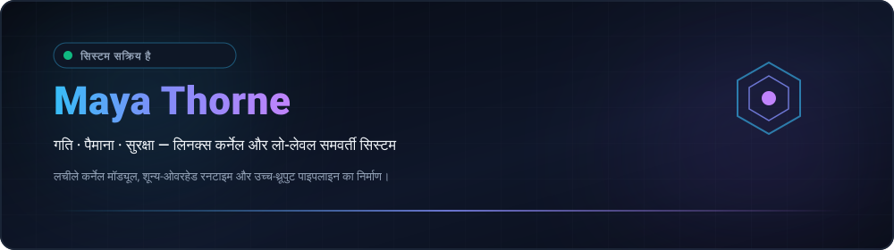

  
  

  <strong>Architecting Resilient Low-Level Systems, Kernel Modules &amp; High-Throughput Concurrency Primitives.</strong> 
  Speed · Scale · Security — Engineering with clarity and conviction. 🚀 ( •̀ᴗ•́ )و

  <a href="../README.md">🇺🇸 English</a> · <a href="./ko.md">🇰🇷 한국어</a> · <a href="./zh-CN.md">🇨🇳 中文</a> · <a href="./es.md">🇪🇸 Español</a> · <strong>🇮🇳 हिन्दी</strong> 
  <a href="./ar.md">🇸🇦 العربية</a> · <a href="./pt-BR.md">🇧🇷 Português</a> · <a href="./ru.md">🇷🇺 Русский</a> · <a href="./fr.md">🇫🇷 Français</a> · <a href="./id.md">🇮🇩 Bahasa Indonesia</a>

  
  
  
  

---

<!-- त्वरित नेविगेशन बार -->

  <a href="#about-engineering-ethos"><b>⚡ परिचय</b></a> &nbsp;•&nbsp;
  <a href="#core-systems-architecture"><b>🚀 13 रिपॉजिटरी प्रदर्शन</b></a> &nbsp;•&nbsp;
  <a href="#featured-capabilities"><b>⚙️ क्षमताएं</b></a> &nbsp;•&nbsp;
  <a href="#technology-stack"><b>💻 तकनीकी स्टैक</b></a> &nbsp;•&nbsp;
  <a href="#explore-projects"><b>🗺️ रोडमैप</b></a> &nbsp;•&nbsp;
  <a href="#architecture-dashboard"><b>📊 मेट्रिक्स</b></a> &nbsp;•&nbsp;
  <a href="#repository-structure"><b>📂 संरचना</b></a>

---

<h2 style="display:inline-block; margin:0;">⚡ About &amp; Engineering Ethos</h2>

 

Architecting resilient low-level software systems, Linux kernel modules, and high-throughput concurrency primitives. Engineering centered around mechanical sympathy and zero-overhead performance:

- ⚡ **Zero-Cost &amp; Mechanical Sympathy** — Code engineered to respect CPU cache hierarchies, memory alignment, and branch predictors. Zero-overhead abstractions by default.
- 🐧 **Kernel-First Architecture** — Treating the operating system kernel not as an opaque abstraction, but as the foundational runtime. Deep instrumentation with io_uring, eBPF, and lockless queues.
- 🛡️ **Invariant-Driven Correctness** — Compile-time safety guarantees, deterministic finite-state machine transitions, lock-free ring buffers, and continuous fuzzing validation.

  <em>(⌐■_■) 💻 "In the terminal we trust. Make it deterministic. Automate the friction away."</em>

---

<h2 style="display:inline-block; margin:0;">🚀 Core Systems & Infrastructure Architecture</h2>

 

5 मुख्य अनुसंधान डोमेन में उच्च-प्रदर्शन वितरित रनटाइम, कर्नेल-बायपास नेटवर्किंग प्रिमिटिव्स और क्रिप्टोग्राफिक रूप से सत्यापित इन्फ्रास्ट्रक्चर टोपोलॉजी इंजन:

### ⚡ लो-लेवल सिस्टम और कर्नेल प्रिमिटिव्स

<table>
  <tr>
    <td width="50%" valign="top">
      

        
      

      <h4><a href="https://github.com/maya-thorne/ring-io">⚡ ring-io</a></h4>
      
<em>लिनक्स io_uring (C23) के माध्यम से हाई-थ्रूपुट, ज़ीरो-ओवरहेड एसिंक्रोनस I/O इंजन।</em>

      

        
        
        
      

      <ul>
        <li>🌀 <strong>ज़ीरो-सिस्टमकॉल रिंग कतार</strong>: epoll/kqueue ओवरहेड को दरकिनार करते हुए लॉक-फ्री सबमिशन (SQ) और कम्प्लीशन (CQ) बफ़र्स</li>
        <li>⚡ <strong>कर्नेल पोलिंग इंजन</strong>: 2.85 Mops/sec बैच प्रोसेसिंग क्षमता प्रदान करने वाले कर्नेल SQPOLL थ्रेड्स</li>
        <li>🔒 <strong>निश्चयात्मक मेमोरी</strong>: शुद्ध C23 आर्किटेक्चर, सीपीयू कैश-एलाइंड डेटा स्ट्रक्चर और ज़ीरो-एलोकेशन रनटाइम</li>
      </ul>
    </td>
    <td width="50%" valign="top">
      

        
      

      <h4><a href="https://github.com/maya-thorne/github-org-map">🗺️ github-org-map</a></h4>
      
<em>सॉल्टेड SHA-256 प्राइवेसी हैशिंग के साथ लिनक्स कर्नेल रिपॉजिटरीज़ की स्वचालित दैनिक टोपोलॉजी मैपिंग।</em>

      

        
        
        
      

      <ul>
        <li>🔄 <strong>सतत कार्टोग्राफी</strong>: कर्नेल अनुसंधान और सिस्टम रिपॉजिटरीज़ को स्वतः मैप करने वाला गिटहब एक्शन वर्कफ़्लो</li>
        <li>🛡️ <strong>वन-वे हैश मास्किंग</strong>: सॉल्टेड SHA-256 द्वारा स्वामित्व वाले कर्नेल एक्सप्लॉइट लैब्स की गोपनीयता सुरक्षा</li>
        <li>📊 <strong>मूल वेक्टर टेलीमेट्री</strong>: बिना किसी निर्भरता वाला शुद्ध 2D SVG कोऑर्डिनेट इंजन और एनिमेटेड टाइमलाइन</li>
      </ul>
    </td>
  </tr>
  <tr>
    <td colspan="2" valign="top">
      

        
      

      <h4><a href="https://github.com/maya-thorne/github-org-map-private">🔒 github-org-map-private</a></h4>
      
<em>लो-लेवल कर्नेल मॉड्यूल, शोषण रक्षा विश्लेषण और निजी अनुसंधान के लिए पृथक साथी टेलीमेट्री पाइपलाइन।</em>

      

        
        
        
      

      <ul>
        <li>🔐 <strong>हार्डवेयर-बाउंड वॉल्ट</strong>: क्रेडेंशियल सुरक्षा सुनिश्चित करने वाला Windows DPAPI एन्क्रिप्टेड सीक्रेट स्टोरेज</li>
        <li>⚡ <strong>निश्चयात्मक दावे</strong>: टकराव-मुक्त मैपिंग और प्री-इमेज प्रतिरोध को सत्यापित करने वाला टेस्ट हार्नेस</li>
        <li>📜 <strong>दोहरा ऑडिट</strong>: सार्वजनिक रूप से छिपे हुए आर्टिफैक्ट्स को आंतरिक ग्राफ़ से मिलाने वाला सतत ऑडिट</li>
      </ul>
    </td>
  </tr>
</table>

### 🔬 बाइनरी रिवर्स इंजीनियरिंग और पैकर विश्लेषण

<table>
  <tr>
    <td width="50%" valign="top">
      

        
      

      <h4><a href="https://github.com/maya-thorne/bat2exe-ghidra-forensics">🔬 bat2exe-ghidra-forensics</a></h4>
      
<em>Ghidra MCP PE बाइनरी रिवर्स इंजीनियरिंग (UPX/CLR/VB6 पैकर्स), 8 कोर टूल्स कोड विश्लेषण और मल्टी-पास AST इंजन।</em>

      

        
        
        
      

      <ul>
        <li>🔬 <strong>Ghidra MCP PE डिसअसेंबली</strong>: bat2exe_12.exe, example.exe (.NET) और BEDeCode.exe (VB6) की गहन बाइनरी जांच</li>
        <li>🛠️ <strong>8 कोर टूल्स का विश्लेषण</strong>: BatCloak, Somalifuscator, 0xidiz3r और Exorcism API हुक का विस्तृत सोर्स कोड अध्ययन</li>
        <li>⚡ <strong>मल्टी-पास AST इंजन</strong>: स्वचालित 6-पास स्टैटिक डीऑबफस्केटर इंजन और एंटरप्राइज सिग्मा/यारा रूल्स</li>
      </ul>
    </td>
    <td width="50%" valign="top">
      

        
      

      <h4><a href="https://github.com/maya-thorne/dotnet-packer-forensics">🔬 dotnet-packer-forensics</a></h4>
      
<em>.NET प्रोटेक्टर्स के लिए स्टैटिक फोरेंसिक अनपैकर, CLR मेटाडेटा विश्लेषण, PE ओवरले कार्विंग और डुअल-XOR आर्काइव।</em>

      

        
        
        
      

      <ul>
        <li>📑 <strong>PE ओवरले कार्विंग</strong>: PE सेक्शन सीमाओं से परे छिपे पेलोड को बिना रन किए निकालने वाला शुद्ध पायथन डिटेक्टर</li>
        <li>🔑 <strong>डुअल-XOR पेलोड निष्कर्षण</strong>: xorPacker/xorStub एन्क्रिप्टेड कंटेनरों के लिए स्वचालित कुंजी पहचान और डिकोडिंग</li>
        <li>🔍 <strong>CLR मेटाडेटा विश्लेषण</strong>: ConfuserEx, .NET Reactor, Babel और ArmDot का ज़ीरो-एक्ज़ीक्यूशन फ़िंगरप्रिंटिंग</li>
      </ul>
    </td>
  </tr>
  <tr>
    <td colspan="2" valign="top">
      

        
      

      <h4><a href="https://github.com/maya-thorne/batch-deobfuscator-re">🔬 batch-deobfuscator-re</a></h4>
      
<em>मल्टी-पास बैच डीऑबफस्केटर इंजन, Ghidra PE अनपैकर फोरेंसिक्स (UPX/LZMA/XOR) और 48+ संदर्भ आर्काइव।</em>

      

        
        
        
      

      <ul>
        <li>🌀 <strong>फिक्स्ड-पॉइंट AST डीऑबफस्केटर</strong>: नेस्टेड वेरिएबल स्लाइसिंग और कैरेट मास्किंग को हटाने वाला पुनरावृत्त रिड्यूसर</li>
        <li>🗜️ <strong>स्टैटिक PE कंटेनर एक्सट्रैक्टर</strong>: कंपाइल किए गए रैपर्स के भीतर एम्बेडेड UPX, LZMA और XOR ओवरले के लिए अनपैकर</li>
        <li>📚 <strong>व्यापक कॉर्पस</strong>: 7 प्रमुख इंजनों का कोड विश्लेषण और 48+ इंडेक्स्ड ओपन-सोर्स व AI संदर्भ संग्रह</li>
      </ul>
    </td>
  </tr>
</table>

### 🛡️ कंपाइलर और AST ऑबफस्केशन रिसर्च

<table>
  <tr>
    <td width="50%" valign="top">
      

        
      

      <h4><a href="https://github.com/maya-thorne/batch-obfuscation-research">🛡️ batch-obfuscation-research</a></h4>
      
<em>विंडोज बैच (cmd.exe) ऑबफस्केशन, डीऑबफस्केशन और बाइनरी रिवर्स इंजीनियरिंग का 30-वर्षीय मास्टर आर्काइव (1990s–2026)।</em>

      

        
        
        
      

      <ul>
        <li>📜 <strong>30-वर्षीय विकास आर्काइव</strong>: 48+ ओपन-सोर्स टूल मिरर्स, मैंडिएंट/डैनियल बोहानन रिसर्च और AI डेटासेट्स</li>
        <li>🧠 <strong>cmd.exe 5-फेज़ पार्सर</strong>: कमांड लाइन विस्तार और पुशडाउन ऑटोमेटा स्टेट मशीनों पर विस्तृत श्वेतपत्र</li>
        <li>🌐 <strong>10-भाषा दस्तावेज़ीकरण</strong>: नियॉन टर्मिनल SVG बैनर्स के साथ पूर्ण स्थानीयकृत तकनीकी दस्तावेज़</li>
      </ul>
    </td>
    <td width="50%" valign="top">
      

        
      

      <h4><a href="https://github.com/maya-thorne/dotnet-obfuscation-and-ghidra-re">🛡️ dotnet-obfuscation-and-ghidra-re</a></h4>
      
<em>ब्लू टीम EDR/SIEM डिटेक्शन इंजीनियरिंग, 52 सिग्मा रूल्स, 32 यारा सिग्नेचर्स, CIL मेटाडेटा फोरेंसिक्स और Ghidra RE सुइट।</em>

      

        
        
        
      

      <ul>
        <li>🛡️ <strong>dnlib और AntiTamper फोरेंसिक्स</strong>: JIT मेथड एन्क्रिप्शन, AntiDump मेमोरी वाइपर्स और करप्टेड #~ टेबल की पहचान</li>
        <li>⚙️ <strong>Ghidra CIL री-डिकम्पाइलेशन</strong>: कस्टम नेटिव VM डिस्पैच लूप्स और डिक्रिप्टर हुक्स को उजागर करने वाली बाइनरी RE</li>
        <li>📊 <strong>एंटरप्राइज SOC रूल्स</strong>: वाणिज्यिक प्रोटेक्टर्स की तकनीकों को कवर करने वाले 52 सिग्मा और 32 यारा नियम</li>
      </ul>
    </td>
  </tr>
  <tr>
    <td colspan="2" valign="top">
      

        
      

      <h4><a href="https://github.com/maya-thorne/cmd-ast-deobfuscator">🛡️ cmd-ast-deobfuscator</a></h4>
      
<em>विंडोज कमांड स्क्रिप्ट्स (cmd.exe / .bat) के लिए मल्टी-पास एब्सट्रैक्ट सिंटैक्स ट्री (AST) और लेक्सिकल डीऑबफस्केटर इंजन।</em>

      

        
        
        
      

      <ul>
        <li>🧩 <strong>मल्टी-पास लेक्सिकल विश्लेषक</strong>: नेस्टेड कैरेट (^), वेरिएबल स्लाइसिंग और विस्मयादिबोधक चिह्नों को पार्स करने वाला ऑटोमेटा</li>
        <li>⚡ <strong>ज़ीरो-एक्ज़ीक्यूशन सामान्यीकरण</strong>: डायनेमिक निष्पादन के बिना मेमोरी में ऑबफस्केटेड पेलोड को सुरक्षित रूप से पुनर्निर्मित करना</li>
        <li>🛡️ <strong>फोरेंसिक पाइपलाइन</strong>: Ghidra RE निष्कर्षों और डिटेक्शन टेलीमेट्री हस्ताक्षरों के साथ सीधा एकीकरण</li>
      </ul>
    </td>
  </tr>
</table>

### 🔍 रक्षात्मक पहचान इंजीनियरिंग और फॉरेंसिक्स

<table>
  <tr>
    <td width="50%" valign="top">
      

        
      

      <h4><a href="https://github.com/maya-thorne/batch-forensics-and-ghidra-re">🛡️ batch-forensics-and-ghidra-re</a></h4>
      
<em>ब्लू टीम EDR/SIEM डिटेक्शन इंजीनियरिंग, 52 सिग्मा रूल्स, 32 यारा सिग्नेचर्स, शैनन एंट्रॉपी और कैरेट डेंसिटी स्कोरर।</em>

      

        
        
        
      

      <ul>
        <li>📐 <strong>शैनन एंट्रॉपी और कैरेट स्कोरर</strong>: कैरेट घनत्व और डेलिमिटर पूर्वाग्रह की गणना करने वाला शुद्ध पायथन डिटेक्टर</li>
        <li>🔍 <strong>Sysmon और इवेंट 4688 कवरेज</strong>: MITRE ATT&CK रक्षात्मक रणनीतियों पर मैप किए गए 52 उत्पादन सिग्मा नियम</li>
        <li>🚀 <strong>रक्षात्मक AST सिम्युलेटर</strong>: स्वचालित SOC ट्राइएज के लिए ज़ीरो-एक्ज़ीक्यूशन कमांड अनएस्केपर</li>
      </ul>
    </td>
    <td width="50%" valign="top">
      

        
      

      <h4><a href="https://github.com/maya-thorne/chromium-app-spoofing-forensics">🛡️ chromium-app-spoofing-forensics</a></h4>
      
<em>ब्लू टीम EDR/SIEM डिटेक्शन इंजीनियरिंग, 52 सिग्मा रूल्स, 32 यारा सिग्नेचर्स, [MS-SHLLINK] बाइनरी कार्विंग और विंडो क्लास ऑडिटर।</em>

      

        
        
        
      

      <ul>
        <li>📑 <strong>[MS-SHLLINK] बाइनरी कार्विंग</strong>: ShellLinkHeader और आइकन स्थान मास्केरेडिंग निकालने वाला शुद्ध पायथन पार्सर</li>
        <li>🔍 <strong>विंडो क्लास पदानुक्रम ऑडिट</strong>: Microsoft Teams/Office के रूप में छिपी Chrome_WidgetWin_1 विंडो की पहचान</li>
        <li>⚡ <strong>टर्नकी SIEM फ़ीड्स</strong>: तत्काल SOC परिनियोजन के लिए तैयार उत्पादन स्प्लंक SPL और इलास्टिक KQL क्वेरीज़</li>
      </ul>
    </td>
  </tr>
</table>

### 🌐 वर्चुअलाइजेशन, इवेज़न फॉरेंसिक्स और प्रोफ़ाइल हब

<table>
  <tr>
    <td width="50%" valign="top">
      

        
      

      <h4><a href="https://github.com/maya-thorne/browser-in-the-browser-virtualization">🌐 browser-in-the-browser-virtualization</a></h4>
      
<em>क्लाइंट-साइड DOM वर्चुअलाइजेशन, सिंथेटिक Omnibox UI स्पूफिंग, ड्रैग फिजिक्स इंजन और बहुस्तरीय रक्षा प्रणाली।</em>

      

        
        
        
      

      <ul>
        <li>🪟 <strong>DOM विंडो वर्चुअलाइजेशन</strong>: सिंथेटिक शीर्षक पट्टी, ड्रैग फ़िज़िक्स और z-index 9999 स्टैकिंग मॉडल का विश्लेषण</li>
        <li>🔬 <strong>स्टैटिक और ह्यूरिस्टिक स्कैनर्स</strong>: नकली एड्रेस बार का पता लगाने वाला पायथन AST विश्लेषक और CSP ऑडिटर</li>
        <li>🛡️ <strong>एंटरप्राइज डिफेंस मैट्रिक्स</strong>: फ्रेम-बस्टिंग ट्रैप्स, MutationObserver गार्ड्स और मल्टी-मॉनिटर एस्केप डिटेक्शन</li>
      </ul>
    </td>
    <td width="50%" valign="top">
      

        
      

      <h4><a href="https://github.com/maya-thorne">💎 maya-thorne (प्रोफ़ाइल और अनुसंधान हब)</a></h4>
      
<em>विशेष गिटहब प्रोफ़ाइल रिपॉजिटरी, 10-भाषा गतिशील कार्टोग्राफी आर्किटेक्चर और स्वचालित टेलीमेट्री सिंक्रोनाइज़ेशन।</em>

      

        
        
        
      

      <ul>
        <li>🌐 <strong>10-भाषा पूर्ण मैट्रिक्स</strong>: 10 अलग-अलग भाषाओं में सिंक्रनाइज़ तकनीकी प्रोफ़ाइल हब की व्यापक उपलब्धता</li>
        <li>📊 <strong>डायनेमिक वेक्टर बैज</strong>: शुद्ध SVG वेक्टर रेंडरिंग, स्ट्रीक स्टैट्स और क्रिप्टोग्राफिक टोपोलॉजी का एकीकरण</li>
        <li>🏛️ <strong>एकीकृत अनुसंधान वर्गीकरण</strong>: 12 विशिष्ट सिस्टम, रिवर्स इंजीनियरिंग और डिटेक्शन रिपॉजिटरीज़ का संयोजन</li>
      </ul>
    </td>
  </tr>
</table>

  <a href="https://github.com/maya-thorne?tab=repositories">सार्वजनिक रिपॉजिटरी ब्राउज़ करें</a> ·
  <a href="https://github.com/maya-thorne/github-org-map">सिस्टम टोपोलॉजी देखें</a>

---

<h2 style="display:inline-block; margin:0;">⚙️ Featured Capabilities &amp; Architectures</h2>

 

<table>
  <tr>
    <td width="50%" valign="top">
      <h4>🐧 Kernel &amp; Low-Level Primitives</h4>
      
<em>Asynchronous I/O via io_uring, kernel-bypass networking, and real-time observability.</em>

      <ul>
        <li>🌀 <strong>io_uring &amp; Async I/O</strong>: High-throughput submission/completion ring queues bypassing legacy epoll overhead.</li>
        <li>⚡ <strong>Kernel Bypass &amp; XDP</strong>: Programmable eBPF/XDP fast-path packet filtering and DPDK user-space acceleration.</li>
        <li>🔒 <strong>Lock-Free Primitives</strong>: SPMC/MPSC atomic queues, hazard pointers, and memory barrier synchronization.</li>
      </ul>
    </td>
    <td width="50%" valign="top">
      <h4>🌐 Distributed Systems &amp; Concurrency</h4>
      
<em>Modern CSP-style concurrency pipelines, zero-copy serialization, and memory-safe systems software.</em>

      <ul>
        <li>🛠️ <strong>Systems Tooling</strong>: Idiomatic modern C23, async and unsafe Rust (no_std), and Zig toolchains.</li>
        <li>📦 <strong>Zero-Copy Data Flow</strong>: Cache-aligned serialization over NVMe storage fabrics and high-bandwidth networking.</li>
        <li>🧪 <strong>Invariant Validation</strong>: State automaton verification, property-based testing, and automated fuzzing suites.</li>
      </ul>
    </td>
  </tr>
</table>

---

<h2 style="display:inline-block; margin:0;">💻 Technology Stack &amp; Tooling</h2>

 

<em>Engineering toolchain for high-performance systems and bare-metal runtime execution:</em>

<table>
  <tr>
    <td width="50%" valign="top">
      <h4>⚙️ Low-Level &amp; Systems</h4>
      <ul>
        <li>🔤 <strong>Languages</strong>: C23, Rust (Async / Unsafe / no_std), Zig, x86_64 / ARM64 Assembly</li>
        <li>🐧 <strong>Kernel Runtimes</strong>: Linux Kernel Modules, POSIX APIs, eBPF / XDP, io_uring</li>
        <li>🧠 <strong>Memory &amp; Concurrency</strong>: Lock-free atomics, SIMD vectorization, NUMA-aware allocators</li>
      </ul>
    </td>
    <td width="50%" valign="top">
      <h4>🌐 Distributed &amp; Infrastructure</h4>
      <ul>
        <li>⚡ <strong>Networking</strong>: Kernel-bypass (DPDK), epoll/kqueue, WebSockets, gRPC</li>
        <li>🔍 <strong>Observability</strong>: bpftrace, perf, Valgrind, GDB, Prometheus telemetry</li>
        <li>🖥️ <strong>Environment</strong>: Arch Linux, Debian, Docker, LLVM/Clang toolchains, Neovim / Tmux</li>
      </ul>
    </td>
  </tr>
</table>

 

  

---

<h2 style="display:inline-block; margin:0;">🗺️ Explore Projects &amp; Roadmaps</h2>

 

<strong>Organization Map &amp; Topology</strong>

  

  Private repositories appear only as masked labels. 
  <a href="https://github.com/maya-thorne/github-org-map">Explore Topology &amp; Cartography →</a>

 

<em>Active roadmap and technical initiatives across low-level infrastructure:</em>

<ul>
  <li>🎯 <strong>Current Focus</strong>: io_uring multi-ring polling benchmarks and kernel module fuzzing harness</li>
  <li>🚀 <strong>Next Milestone</strong>: Lock-free SPMC work-stealing scheduler with NUMA cache-pinning</li>
  <li>🔬 <strong>Research Track</strong>: eBPF-driven network flow router with hardware offloading</li>
</ul>

---

<h2 style="display:inline-block; margin:0;">📊 Architecture Dashboard &amp; Delivery Metrics</h2>

 

  

    
    
  

---

<h2 style="display:inline-block; margin:0;">📁 प्रोफ़ाइल रिपॉजिटरी संरचना और निर्देशिका मानचित्र</h2>

 

<table width="100%">
  <thead>
    <tr>
      <th width="30%" align="left"><nobr>📁 पथ / संपत्ति</nobr></th>
      <th width="20%" align="left"><nobr>⚙️ श्रेणी</nobr></th>
      <th width="50%" align="left"><nobr>📝 इंजीनियरिंग उत्तरदायित्व</nobr></th>
    </tr>
  </thead>
  <tbody>
    <tr>
      <td><strong><code>assets/projects/</code></strong></td>
      <td>वेक्टर संपत्तियां</td>
      <td>सभी 13 सिस्टम अनुसंधान रिपॉजिटरी के लिए उच्च-रिज़ॉल्यूशन एसवीजी प्रोजेक्ट बैनर (100% एक्सएमएल मान्य)</td>
    </tr>
    <tr>
      <td><strong><code>assets/badges/</code></strong></td>
      <td>विज़ुअल टेलीमेट्री</td>
      <td>फ़ोकस क्षेत्रों, टेलीमेट्री स्थिति और सुरक्षा विशिष्टताओं के लिए कस्टम वेक्टर बैज</td>
    </tr>
    <tr>
      <td><strong><code>assets/stats/</code></strong></td>
      <td>मेट्रिक्स टेलीमेट्री</td>
      <td>रीयल-टाइम आर्किटेक्चर और योगदान टेलीमेट्री एसवीजी बैज</td>
    </tr>
    <tr>
      <td><strong><code>locales/</code></strong></td>
      <td>अंतर्राष्ट्रीयकरण</td>
      <td>10-भाषा वैश्विक स्थानीयकृत प्रोफ़ाइल शोकेस (<code>ar</code>, <code>en</code>, <code>es</code>, <code>fr</code>, <code>hi</code>, <code>id</code>, <code>ko</code>, <code>pt-BR</code>, <code>ru</code>, <code>zh-CN</code>)</td>
    </tr>
    <tr>
      <td><strong><code>avatar.svg</code></strong></td>
      <td>ब्रांडिंग संपत्ति</td>
      <td>माया थॉर्न का स्वच्छ ज्यामितीय वेक्टर मोनोग्राम</td>
    </tr>
    <tr>
      <td><strong><code>hero.svg</code></strong></td>
      <td>ब्रांडिंग संपत्ति</td>
      <td>उत्तरदायी वाइडस्क्रीन टर्मिनल-थीम वाला हेडर बैनर</td>
    </tr>
    <tr>
      <td><strong><code>.gitignore</code></strong></td>
      <td>सुरक्षा सीमा</td>
      <td>शून्य-रिसाव अलगाव सीमा जो एआई मेमोरी, क्रेडेंशियल्स और ओएस कैश कलाकृतियों को अवरुद्ध करती है</td>
    </tr>
    <tr>
      <td><strong><code>LICENSE</code></strong></td>
      <td>कानूनी / लाइसेंस</td>
      <td>माया थॉर्न सिस्टम्स एंड सिक्योरिटी रिसर्च लाइसेंस (MT-SRL)</td>
    </tr>
    <tr>
      <td><strong><code>README.md</code></strong></td>
      <td>मुख्य प्रवेश बिंदु</td>
      <td>5 सिस्टम डोमेन में 13 अनुसंधान रिपॉजिटरी की विशेषता वाला केंद्रीय गिटहब प्रोफ़ाइल डैशबोर्ड</td>
    </tr>
  </tbody>
</table>

---

## 📬 Connect &amp; Collaborate

Interested in discussing low-level systems architectures, Linux kernel internals, or high-performance concurrency primitives? (ง •̀_•́)ง

🐙 [GitHub Profile](https://github.com/maya-thorne) · 📦 [Public Repositories](https://github.com/maya-thorne?tab=repositories) · 💬 [Discussions](https://github.com/maya-thorne?tab=discussions) · ✉️ [Send an Email](mailto:zse4123jo@gmail.com)

   
  © 2026 Maya Thorne · Systems Architecture &amp; Kernel Engineering ( 💻 ˘◡˘ )

