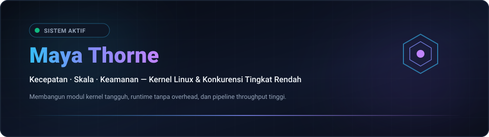

  
  

  <strong>Architecting Resilient Low-Level Systems, Kernel Modules &amp; High-Throughput Concurrency Primitives.</strong> 
  Speed · Scale · Security — Engineering with clarity and conviction. 🚀 ( •̀ᴗ•́ )و

  <a href="../README.md">🇺🇸 English</a> · <a href="./ko.md">🇰🇷 한국어</a> · <a href="./zh-CN.md">🇨🇳 中文</a> · <a href="./es.md">🇪🇸 Español</a> · <a href="./hi.md">🇮🇳 हिन्दी</a> 
  <a href="./ar.md">🇸🇦 العربية</a> · <a href="./pt-BR.md">🇧🇷 Português</a> · <a href="./ru.md">🇷🇺 Русский</a> · <a href="./fr.md">🇫🇷 Français</a> · <strong>🇮🇩 Bahasa Indonesia</strong>

  
  
  
  

---

<!-- Bilah Navigasi Cepat -->

  <a href="#about-engineering-ethos"><b>⚡ Tentang</b></a> &nbsp;•&nbsp;
  <a href="#core-systems-architecture"><b>🚀 Showcase 13 Repositori</b></a> &nbsp;•&nbsp;
  <a href="#featured-capabilities"><b>⚙️ Kemampuan</b></a> &nbsp;•&nbsp;
  <a href="#technology-stack"><b>💻 Stack Teknologi</b></a> &nbsp;•&nbsp;
  <a href="#explore-projects"><b>🗺️ Roadmap</b></a> &nbsp;•&nbsp;
  <a href="#architecture-dashboard"><b>📊 Metrik</b></a> &nbsp;•&nbsp;
  <a href="#repository-structure"><b>📂 Struktur</b></a>

---

<h2 style="display:inline-block; margin:0;">⚡ About &amp; Engineering Ethos</h2>

 

Architecting resilient low-level software systems, Linux kernel modules, and high-throughput concurrency primitives. Engineering centered around mechanical sympathy and zero-overhead performance:

- ⚡ **Zero-Cost &amp; Mechanical Sympathy** — Code engineered to respect CPU cache hierarchies, memory alignment, and branch predictors. Zero-overhead abstractions by default.
- 🐧 **Kernel-First Architecture** — Treating the operating system kernel not as an opaque abstraction, but as the foundational runtime. Deep instrumentation with io_uring, eBPF, and lockless queues.
- 🛡️ **Invariant-Driven Correctness** — Compile-time safety guarantees, deterministic finite-state machine transitions, lock-free ring buffers, and continuous fuzzing validation.

  <em>(⌐■_■) 💻 "In the terminal we trust. Make it deterministic. Automate the friction away."</em>

---

<h2 style="display:inline-block; margin:0;">🚀 Core Systems & Infrastructure Architecture</h2>

 

Runtime terdistribusi performa tinggi, primitif jaringan kernel-bypass, dan mesin topologi infrastruktur terverifikasi secara kriptografi di 5 domain riset utama:

### ⚡ Sistem Tingkat Rendah & Primitif Kernel

<table>
  <tr>
    <td width="50%" valign="top">
      

        
      

      <h4><a href="https://github.com/maya-thorne/ring-io">⚡ ring-io</a></h4>
      
<em>Mesin I/O asinkron berkecepatan tinggi tanpa overhead melalui Linux io_uring (standar C23).</em>

      

        
        
        
      

      <ul>
        <li>🌀 <strong>Antrean Cincin Tanpa Syscall</strong>: Buffer cincin pengajuan (SQ) dan penyelesaian (CQ) lock-free tanpa latensi epoll/kqueue</li>
        <li>⚡ <strong>Mesin Polling Kernel</strong>: Thread pekerja kernel SQPOLL menghasilkan pemrosesan batch 2.85 Mops/sec</li>
        <li>🔒 <strong>Memori Deterministik</strong>: Arsitektur murni C23, perataan cache CPU, dan runtime tanpa alokasi dinamis</li>
      </ul>
    </td>
    <td width="50%" valign="top">
      

        
      

      <h4><a href="https://github.com/maya-thorne/github-org-map">🗺️ github-org-map</a></h4>
      
<em>Pemetaan topologi harian otomatis untuk repositori kernel Linux dan runtime konkurensi dengan hashing privasi SHA-256.</em>

      

        
        
        
      

      <ul>
        <li>🔄 <strong>Kartografi Berkelanjutan</strong>: Alur kerja GitHub Actions terjadwal memetakan riset kernel dan sistem</li>
        <li>🛡️ <strong>Penyamaran Hash Satu Arah</strong>: Hashing SHA-256 dengan salt menyembunyikan lab eksploitasi kernel secara aman</li>
        <li>📊 <strong>Telemetri Vektor Asli</strong>: Mesin koordinat 2D SVG murni tanpa dependensi dengan animasi linimasa presisi bingkai</li>
      </ul>
    </td>
  </tr>
  <tr>
    <td colspan="2" valign="top">
      

        
      

      <h4><a href="https://github.com/maya-thorne/github-org-map-private">🔒 github-org-map-private</a></h4>
      
<em>Saluran telemetri pendamping terisolasi untuk modul kernel tingkat rendah dan analisis pertahanan eksploitasi.</em>

      

        
        
        
      

      <ul>
        <li>🔐 <strong>Kubah Terikat Perangkat Keras</strong>: Enkripsi rahasia Windows DPAPI memastikan keamanan kredensial tingkat fisik</li>
        <li>⚡ <strong>Asersi Deterministik</strong>: Harness pengujian otomatis memverifikasi resistensi pra-gambar dan pemetaan bebas tabrakan</li>
        <li>📜 <strong>Audit Kebenaran Ganda</strong>: Saluran audit berkelanjutan mencocokkan artefak publik bertopeng dengan grafik internal</li>
      </ul>
    </td>
  </tr>
</table>

### 🔬 Rekayasa Balik Biner & Analisis Packer

<table>
  <tr>
    <td width="50%" valign="top">
      

        
      

      <h4><a href="https://github.com/maya-thorne/bat2exe-ghidra-forensics">🔬 bat2exe-ghidra-forensics</a></h4>
      
<em>Rekayasa balik biner PE Ghidra MCP (packer Bat2Exe UPX/CLR/VB6), bedah kode sumber 8 alat obfuskasi, dan mesin AST.</em>

      

        
        
        
      

      <ul>
        <li>🔬 <strong>Disassembly PE Ghidra MCP</strong>: Analisis mendalam struktur biner kemasan UPX, .NET CLR, dan VB6</li>
        <li>🛠️ <strong>Bedah 8 Alat Utama</strong>: Analisis baris per baris BatCloak poliglota, Somalifuscator, 0xidiz3r, dan hook Exorcism</li>
        <li>⚡ <strong>Mesin AST Multi-Pass</strong>: Deobfuskator statis 6-tahap (src/deobfuscator_engine.py) dan aturan deteksi Sigma/YARA</li>
      </ul>
    </td>
    <td width="50%" valign="top">
      

        
      

      <h4><a href="https://github.com/maya-thorne/dotnet-packer-forensics">🔬 dotnet-packer-forensics</a></h4>
      
<em>Unpacker forensik statis tanpa eksekusi, analisis metadata CLR, carving overlay PE, dan arsip riset dual-XOR untuk .NET.</em>

      

        
        
        
      

      <ul>
        <li>📑 <strong>Carving Overlay PE</strong>: Detektor Python murni mengekstrak payload tersembunyi di luar batas seksi fisik PE</li>
        <li>🔑 <strong>Ekstraksi Dual-XOR</strong>: Deteksi kunci otomatis dan decoding untuk wadah PE terenkripsi xorPacker / xorStub</li>
        <li>🔍 <strong>Analisis Metadata CLR</strong>: Fingerprinting tanpa eksekusi untuk ConfuserEx, .NET Reactor, Babel, dan ArmDot</li>
      </ul>
    </td>
  </tr>
  <tr>
    <td colspan="2" valign="top">
      

        
      

      <h4><a href="https://github.com/maya-thorne/batch-deobfuscator-re">🔬 batch-deobfuscator-re</a></h4>
      
<em>Mesin deobfuskasi batch multi-pass, forensik unpacker PE Ghidra (UPX/LZMA/XOR), dan arsip 48+ referensi open-source.</em>

      

        
        
        
      

      <ul>
        <li>🌀 <strong>Deobfuskator AST Titik Tetap</strong>: Reduser iteratif yang mengupas pemotongan variabel bertingkat dan masking caret</li>
        <li>🗜️ <strong>Pengekstrak Wadah PE Statis</strong>: Unpacker untuk overlay UPX, LZMA, dan XOR mentah di dalam wrapper yang dikompilasi</li>
        <li>📚 <strong>Korpus Komprehensif</strong>: Bedah 7 mesin deobfuskasi unggulan dipadukan dengan 48+ korpus referensi open-source & AI</li>
      </ul>
    </td>
  </tr>
</table>

### 🛡️ Obfuskasi Kompiler & AST

<table>
  <tr>
    <td width="50%" valign="top">
      

        
      

      <h4><a href="https://github.com/maya-thorne/batch-obfuscation-research">🛡️ batch-obfuscation-research</a></h4>
      
<em>Arsip master riset obfuskasi, deobfuskasi, dan rekayasa balik biner batch Windows selama 30 tahun (1990-an–2026).</em>

      

        
        
        
      

      <ul>
        <li>📜 <strong>Arsip Evolusi 30 Tahun</strong>: 48+ cermin alat open-source, riset Mandiant/Daniel Bohannon, dan dataset AI</li>
        <li>🧠 <strong>Parser 5 Fase cmd.exe</strong>: Dokumen komprehensif tentang urutan ekspansi variabel dan state machine pushdown automaton</li>
        <li>🌐 <strong>Dokumentasi 10 Bahasa</strong>: Dokumentasi teknis terjemahan lengkap dengan banner terminal SVG neon</li>
      </ul>
    </td>
    <td width="50%" valign="top">
      

        
      

      <h4><a href="https://github.com/maya-thorne/dotnet-obfuscation-and-ghidra-re">🛡️ dotnet-obfuscation-and-ghidra-re</a></h4>
      
<em>Rekayasa deteksi EDR/SIEM Blue Team, 52 aturan Sigma, 32 tanda tangan YARA, forensik CIL, dan suite RE Ghidra.</em>

      

        
        
        
      

      <ul>
        <li>🛡️ <strong>Forensik dnlib & AntiTamper</strong>: Deteksi statis enkripsi metode JIT, penghapus memori AntiDump, dan header tabel #~ korup</li>
        <li>⚙️ <strong>Dekomplikasi Ulang CIL di Ghidra</strong>: Alur RE biner mengungkap loop dispatch mesin virtual native dan hook dekriptor</li>
        <li>📊 <strong>Koleksi Aturan SOC Enterprise</strong>: 52 aturan Sigma modular dan 32 tanda tangan YARA mencakup teknik evasif komersial</li>
      </ul>
    </td>
  </tr>
  <tr>
    <td colspan="2" valign="top">
      

        
      

      <h4><a href="https://github.com/maya-thorne/cmd-ast-deobfuscator">🛡️ cmd-ast-deobfuscator</a></h4>
      
<em>Mesin analisis leksikal dan Abstract Syntax Tree (AST) multi-pass untuk skrip perintah Windows (cmd.exe / .bat).</em>

      

        
        
        
      

      <ul>
        <li>🧩 <strong>Penganalisis Leksikal Multi-Pass</strong>: Pushdown automaton mengurai penyisipan tanda caret (^), pemotongan persen, dan tanda seru</li>
        <li>⚡ <strong>Normalizer Aman Tanpa Eksekusi</strong>: Evaluasi aman dalam memori yang merekonstruksi muatan tanpa menjalankan interpreter</li>
        <li>🛡️ <strong>Saluran Forensik</strong>: Integrasi langsung dengan temuan Ghidra RE dan tanda tangan telemetri deteksi</li>
      </ul>
    </td>
  </tr>
</table>

### 🔍 Rekayasa Deteksi Defensif & Forensik Blue Team

<table>
  <tr>
    <td width="50%" valign="top">
      

        
      

      <h4><a href="https://github.com/maya-thorne/batch-forensics-and-ghidra-re">🛡️ batch-forensics-and-ghidra-re</a></h4>
      
<em>Rekayasa deteksi EDR/SIEM Blue Team, 52 aturan Sigma, 32 tanda tangan YARA, skor entropi Shannon & kepadatan tanda sisip (^).</em>

      

        
        
        
      

      <ul>
        <li>📐 <strong>Pemberi Skor Entropi Shannon & Caret</strong>: Detektor Python statis (src/entropy_detector.py) menghitung kepadatan tanda caret dan deviasi</li>
        <li>🔍 <strong>Cakupan Sysmon & Event 4688</strong>: 52 aturan Sigma produksi yang dipetakan ke taktik Evasion, Execution, dan Persistence MITRE</li>
        <li>🚀 <strong>Simulator AST Defensif</strong>: Pengurai unescape perintah dalam memori (src/cmd_parser_simulator.py) untuk triase SOC otomatis</li>
      </ul>
    </td>
    <td width="50%" valign="top">
      

        
      

      <h4><a href="https://github.com/maya-thorne/chromium-app-spoofing-forensics">🛡️ chromium-app-spoofing-forensics</a></h4>
      
<em>Rekayasa deteksi EDR/SIEM, 52 aturan Sigma, 32 tanda tangan YARA, carving biner [MS-SHLLINK], dan audit penyamaran kelas jendela.</em>

      

        
        
        
      

      <ul>
        <li>📑 <strong>Carving Biner [MS-SHLLINK]</strong>: Parser Python murni mengekstrak ShellLinkHeader dan manipulasi ikon pintasan</li>
        <li>🔍 <strong>Audit Hierarki Kelas Jendela</strong>: Mengidentifikasi jendela stripped Chrome_WidgetWin_1 yang menyamar sebagai Teams/Office</li>
        <li>⚡ <strong>Feed SIEM Siap Pakai</strong>: Kueri produksi Splunk SPL dan Elasticsearch KQL siap diluncurkan di pusat operasi SOC</li>
      </ul>
    </td>
  </tr>
</table>

### 🌐 Virtualisasi, Forensik Evasif & Hub Profil

<table>
  <tr>
    <td width="50%" valign="top">
      

        
      

      <h4><a href="https://github.com/maya-thorne/browser-in-the-browser-virtualization">🌐 browser-in-the-browser-virtualization</a></h4>
      
<em>Virtualisasi DOM sisi klien, pemalsuan UI Omnibox sintetis, mesin fisika drag-and-drop, dan matriks pertahanan bertingkat.</em>

      

        
        
        
      

      <ul>
        <li>🪟 <strong>Virtualisasi Jendela DOM</strong>: Title bar sintetis OS, fisika seret (drag-and-drop), dan konteks susun z-index 9999</li>
        <li>🔬 <strong>Pemindai Statis & Heuristik</strong>: Penganalisis Python AST mendeteksi Omnibox palsu dan mengaudit kebijakan CSP</li>
        <li>🛡️ <strong>Matriks Pertahanan Perusahaan</strong>: Jebakan frame-busting, penjaga MutationObserver DOM, dan deteksi lolos multi-monitor</li>
      </ul>
    </td>
    <td width="50%" valign="top">
      

        
      

      <h4><a href="https://github.com/maya-thorne">💎 maya-thorne (Hub Profil & Riset)</a></h4>
      
<em>Repositori profil GitHub khusus, arsitektur kartografi dinamis 10 bahasa, dan mesin sinkronisasi telemetri otomatis.</em>

      

        
        
        
      

      <ul>
        <li>🌐 <strong>Matriks Lengkap 10 Bahasa</strong>: Hub profil teknis terkoordinasi mencakup ar, en, es, fr, hi, id, ko, pt-BR, ru, dan zh-CN</li>
        <li>📊 <strong>Sistem Lencana Vektor Dinamis</strong>: Rendering vektor SVG murni, statistik streak, dan integrasi topologi kriptografi</li>
        <li>🏛️ <strong>Taksonomi Riset Terpadu</strong>: Kategorisasi terpadu menghubungkan 12 repositori spesialis sistem, RE, dan deteksi defensif</li>
      </ul>
    </td>
  </tr>
</table>

  <a href="https://github.com/maya-thorne?tab=repositories">Jelajahi Repositori Publik</a> ·
  <a href="https://github.com/maya-thorne/github-org-map">Eksplorasi Topologi Sistem</a>

---

<h2 style="display:inline-block; margin:0;">⚙️ Featured Capabilities &amp; Architectures</h2>

 

<table>
  <tr>
    <td width="50%" valign="top">
      <h4>🐧 Kernel &amp; Low-Level Primitives</h4>
      
<em>Asynchronous I/O via io_uring, kernel-bypass networking, and real-time observability.</em>

      <ul>
        <li>🌀 <strong>io_uring &amp; Async I/O</strong>: High-throughput submission/completion ring queues bypassing legacy epoll overhead.</li>
        <li>⚡ <strong>Kernel Bypass &amp; XDP</strong>: Programmable eBPF/XDP fast-path packet filtering and DPDK user-space acceleration.</li>
        <li>🔒 <strong>Lock-Free Primitives</strong>: SPMC/MPSC atomic queues, hazard pointers, and memory barrier synchronization.</li>
      </ul>
    </td>
    <td width="50%" valign="top">
      <h4>🌐 Distributed Systems &amp; Concurrency</h4>
      
<em>Modern CSP-style concurrency pipelines, zero-copy serialization, and memory-safe systems software.</em>

      <ul>
        <li>🛠️ <strong>Systems Tooling</strong>: Idiomatic modern C23, async and unsafe Rust (no_std), and Zig toolchains.</li>
        <li>📦 <strong>Zero-Copy Data Flow</strong>: Cache-aligned serialization over NVMe storage fabrics and high-bandwidth networking.</li>
        <li>🧪 <strong>Invariant Validation</strong>: State automaton verification, property-based testing, and automated fuzzing suites.</li>
      </ul>
    </td>
  </tr>
</table>

---

<h2 style="display:inline-block; margin:0;">💻 Technology Stack &amp; Tooling</h2>

 

<em>Engineering toolchain for high-performance systems and bare-metal runtime execution:</em>

<table>
  <tr>
    <td width="50%" valign="top">
      <h4>⚙️ Low-Level &amp; Systems</h4>
      <ul>
        <li>🔤 <strong>Languages</strong>: C23, Rust (Async / Unsafe / no_std), Zig, x86_64 / ARM64 Assembly</li>
        <li>🐧 <strong>Kernel Runtimes</strong>: Linux Kernel Modules, POSIX APIs, eBPF / XDP, io_uring</li>
        <li>🧠 <strong>Memory &amp; Concurrency</strong>: Lock-free atomics, SIMD vectorization, NUMA-aware allocators</li>
      </ul>
    </td>
    <td width="50%" valign="top">
      <h4>🌐 Distributed &amp; Infrastructure</h4>
      <ul>
        <li>⚡ <strong>Networking</strong>: Kernel-bypass (DPDK), epoll/kqueue, WebSockets, gRPC</li>
        <li>🔍 <strong>Observability</strong>: bpftrace, perf, Valgrind, GDB, Prometheus telemetry</li>
        <li>🖥️ <strong>Environment</strong>: Arch Linux, Debian, Docker, LLVM/Clang toolchains, Neovim / Tmux</li>
      </ul>
    </td>
  </tr>
</table>

 

  

---

<h2 style="display:inline-block; margin:0;">🗺️ Explore Projects &amp; Roadmaps</h2>

 

<strong>Organization Map &amp; Topology</strong>

  

  Private repositories appear only as masked labels. 
  <a href="https://github.com/maya-thorne/github-org-map">Explore Topology &amp; Cartography →</a>

 

<em>Active roadmap and technical initiatives across low-level infrastructure:</em>

<ul>
  <li>🎯 <strong>Current Focus</strong>: io_uring multi-ring polling benchmarks and kernel module fuzzing harness</li>
  <li>🚀 <strong>Next Milestone</strong>: Lock-free SPMC work-stealing scheduler with NUMA cache-pinning</li>
  <li>🔬 <strong>Research Track</strong>: eBPF-driven network flow router with hardware offloading</li>
</ul>

---

<h2 style="display:inline-block; margin:0;">📊 Architecture Dashboard &amp; Delivery Metrics</h2>

 

  

    
    
  

---

<h2 style="display:inline-block; margin:0;">📁 Struktur Repositori Profil &amp; Peta Direktori</h2>

 

<table width="100%">
  <thead>
    <tr>
      <th width="30%" align="left"><nobr>📁 Jalur / Aset</nobr></th>
      <th width="20%" align="left"><nobr>⚙️ Kategori</nobr></th>
      <th width="50%" align="left"><nobr>📝 Tanggung Jawab Rekayasa</nobr></th>
    </tr>
  </thead>
  <tbody>
    <tr>
      <td><strong><code>assets/projects/</code></strong></td>
      <td>Aset Vektor</td>
      <td>Spanduk proyek SVG resolusi tinggi untuk 13 repositori riset sistem (100% XML valid)</td>
    </tr>
    <tr>
      <td><strong><code>assets/badges/</code></strong></td>
      <td>Telemetri Visual</td>
      <td>Lencana vektor kustom untuk area fokus, status telemetri, dan spesifikasi keamanan</td>
    </tr>
    <tr>
      <td><strong><code>assets/stats/</code></strong></td>
      <td>Telemetri Metrik</td>
      <td>Lencana SVG telemetri arsitektur dan kontribusi waktu nyata</td>
    </tr>
    <tr>
      <td><strong><code>locales/</code></strong></td>
      <td>Internasionalisasi</td>
      <td>Showcase profil global yang dilokalisasi dalam 10 bahasa (<code>ar</code>, <code>en</code>, <code>es</code>, <code>fr</code>, <code>hi</code>, <code>id</code>, <code>ko</code>, <code>pt-BR</code>, <code>ru</code>, <code>zh-CN</code>)</td>
    </tr>
    <tr>
      <td><strong><code>avatar.svg</code></strong></td>
      <td>Aset Branding</td>
      <td>Monogram vektor geometris bersih dari Maya Thorne</td>
    </tr>
    <tr>
      <td><strong><code>hero.svg</code></strong></td>
      <td>Aset Branding</td>
      <td>Spanduk tajuk bertema terminal layar lebar yang responsif</td>
    </tr>
    <tr>
      <td><strong><code>.gitignore</code></strong></td>
      <td>Batas Keamanan</td>
      <td>Batas isolasi tanpa kebocoran yang memblokir memori AI, kredensial, dan artefak cache OS</td>
    </tr>
    <tr>
      <td><strong><code>LICENSE</code></strong></td>
      <td>Legal / Lisensi</td>
      <td>Maya Thorne Systems &amp; Security Research License (MT-SRL)</td>
    </tr>
    <tr>
      <td><strong><code>README.md</code></strong></td>
      <td>Titik Masuk Utama</td>
      <td>Dasbor profil GitHub utama yang menampilkan 13 repositori riset di 5 domain sistem</td>
    </tr>
  </tbody>
</table>

---

## 📬 Connect &amp; Collaborate

Interested in discussing low-level systems architectures, Linux kernel internals, or high-performance concurrency primitives? (ง •̀_•́)ง

🐙 [GitHub Profile](https://github.com/maya-thorne) · 📦 [Public Repositories](https://github.com/maya-thorne?tab=repositories) · 💬 [Discussions](https://github.com/maya-thorne?tab=discussions) · ✉️ [Send an Email](mailto:zse4123jo@gmail.com)

   
  © 2026 Maya Thorne · Systems Architecture &amp; Kernel Engineering ( 💻 ˘◡˘ )

