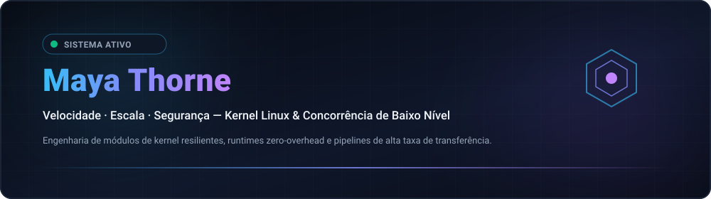

  
  

  <strong>Architecting Resilient Low-Level Systems, Kernel Modules &amp; High-Throughput Concurrency Primitives.</strong> 
  Speed · Scale · Security — Engineering with clarity and conviction. 🚀 ( •̀ᴗ•́ )و

  <a href="../README.md">🇺🇸 English</a> · <a href="./ko.md">🇰🇷 한국어</a> · <a href="./zh-CN.md">🇨🇳 中文</a> · <a href="./es.md">🇪🇸 Español</a> · <a href="./hi.md">🇮🇳 हिन्दी</a> 
  <a href="./ar.md">🇸🇦 العربية</a> · <strong>🇧🇷 Português</strong> · <a href="./ru.md">🇷🇺 Русский</a> · <a href="./fr.md">🇫🇷 Français</a> · <a href="./id.md">🇮🇩 Bahasa Indonesia</a>

  
  
  
  

---

<!-- Barra de Navegação Rápida -->

  <a href="#about-engineering-ethos"><b>⚡ Sobre</b></a> &nbsp;•&nbsp;
  <a href="#core-systems-architecture"><b>🚀 Vitrine de 13 Repositórios</b></a> &nbsp;•&nbsp;
  <a href="#featured-capabilities"><b>⚙️ Capacidades</b></a> &nbsp;•&nbsp;
  <a href="#technology-stack"><b>💻 Stack Tecnológico</b></a> &nbsp;•&nbsp;
  <a href="#explore-projects"><b>🗺️ Roteiros</b></a> &nbsp;•&nbsp;
  <a href="#architecture-dashboard"><b>📊 Métricas</b></a> &nbsp;•&nbsp;
  <a href="#repository-structure"><b>📂 Estrutura</b></a>

---

<h2 style="display:inline-block; margin:0;">⚡ About &amp; Engineering Ethos</h2>

 

Architecting resilient low-level software systems, Linux kernel modules, and high-throughput concurrency primitives. Engineering centered around mechanical sympathy and zero-overhead performance:

- ⚡ **Zero-Cost &amp; Mechanical Sympathy** — Code engineered to respect CPU cache hierarchies, memory alignment, and branch predictors. Zero-overhead abstractions by default.
- 🐧 **Kernel-First Architecture** — Treating the operating system kernel not as an opaque abstraction, but as the foundational runtime. Deep instrumentation with io_uring, eBPF, and lockless queues.
- 🛡️ **Invariant-Driven Correctness** — Compile-time safety guarantees, deterministic finite-state machine transitions, lock-free ring buffers, and continuous fuzzing validation.

  <em>(⌐■_■) 💻 "In the terminal we trust. Make it deterministic. Automate the friction away."</em>

---

<h2 style="display:inline-block; margin:0;">🚀 Core Systems & Infrastructure Architecture</h2>

 

Runtimes distribuídos de alto desempenho, primitivas de rede com bypass de kernel e motores de topologia de infraestrutura criptograficamente verificados em 5 domínios de pesquisa:

### ⚡ Sistemas de Baixo Nível e Primitivas de Kernel

<table>
  <tr>
    <td width="50%" valign="top">
      

        
      

      <h4><a href="https://github.com/maya-thorne/ring-io">⚡ ring-io</a></h4>
      
<em>Motor de E/S assíncrona de alto rendimento e sobrecarga zero via Linux io_uring (C23).</em>

      

        
        
        
      

      <ul>
        <li>🌀 <strong>Fila Circular Sem Syscalls</strong>: Buffers de envio (SQ) e conclusão (CQ) lock-free contornando epoll/kqueue</li>
        <li>⚡ <strong>Motor de Polling do Kernel</strong>: Threads SQPOLL no kernel alcançando 2.85 Mops/sec em processamento em lote</li>
        <li>🔒 <strong>Memória Determinística</strong>: Arquitetura pura C23, estruturas alinhadas à linha de cache e zero alocações</li>
      </ul>
    </td>
    <td width="50%" valign="top">
      

        
      

      <h4><a href="https://github.com/maya-thorne/github-org-map">🗺️ github-org-map</a></h4>
      
<em>Mapeamento topológico diário automatizado de repositórios do kernel Linux com hashing de privacidade SHA-256.</em>

      

        
        
        
      

      <ul>
        <li>🔄 <strong>Cartografia Contínua</strong>: Fluxo agendado no GitHub Actions mapeando repositórios de kernel e sistemas</li>
        <li>🛡️ <strong>Mascaramento Hash Unidirecional</strong>: Hashing SHA-256 com sal ocultando labs proprietários e mantendo a linhagem</li>
        <li>📊 <strong>Telemetria Vetorial Nativa</strong>: Motor 2D SVG puro sem dependências com geração precisa de linha do tempo animada</li>
      </ul>
    </td>
  </tr>
  <tr>
    <td colspan="2" valign="top">
      

        
      

      <h4><a href="https://github.com/maya-thorne/github-org-map-private">🔒 github-org-map-private</a></h4>
      
<em>Pipeline de telemetria complementar isolado para módulos de kernel, análise de defesa de exploits e pesquisa de arquitetura privada.</em>

      

        
        
        
      

      <ul>
        <li>🔐 <strong>Cofre Vinculado ao Hardware</strong>: Encapsulamento criptografado via Windows DPAPI garantindo segurança física de credenciais</li>
        <li>⚡ <strong>Asserções Determinísticas</strong>: Testes automatizados verificando resistência a pré-imagem e mapeamento livre de colisões</li>
        <li>📜 <strong>Auditoria de Base Dupla</strong>: Pipeline contínuo validando artefatos públicos mascarados contra o grafo interno</li>
      </ul>
    </td>
  </tr>
</table>

### 🔬 Engenharia Reversa de Binários e Packers

<table>
  <tr>
    <td width="50%" valign="top">
      

        
      

      <h4><a href="https://github.com/maya-thorne/bat2exe-ghidra-forensics">🔬 bat2exe-ghidra-forensics</a></h4>
      
<em>Engenharia reversa de binários PE com Ghidra MCP (packers Bat2Exe UPX/CLR/VB6), dissecação de código de 8 ofuscadores e motor AST.</em>

      

        
        
        
      

      <ul>
        <li>🔬 <strong>Desmontagem PE no Ghidra</strong>: Análise profunda de executáveis compactados com UPX, .NET CLR e VB6</li>
        <li>🛠️ <strong>Dissecação de 8 Ferramentas</strong>: Engenharia reversa linha por linha de BatCloak, Somalifuscator, 0xidiz3r e Exorcism</li>
        <li>⚡ <strong>Motor AST Multi-Passo</strong>: Desofuscador estático de 6 passos (src/deobfuscator_engine.py) e regras Sigma/YARA</li>
      </ul>
    </td>
    <td width="50%" valign="top">
      

        
      

      <h4><a href="https://github.com/maya-thorne/dotnet-packer-forensics">🔬 dotnet-packer-forensics</a></h4>
      
<em>Desempacotador forense estático sem execução, análise de metadatos CLR, extração de overlay PE e arquivo de pesquisa dual-XOR.</em>

      

        
        
        
      

      <ul>
        <li>📑 <strong>Carving de Overlays PE</strong>: Detector em Python que extrai cargas úteis ocultas além dos limites de seção do PE</li>
        <li>🔑 <strong>Extração Dual-XOR</strong>: Detecção automática de chave e decodificação para contêineres cifrados com xorPacker</li>
        <li>🔍 <strong>Análise de Metadados CLR</strong>: Fingerprinting sem execução de ConfuserEx, .NET Reactor, Babel e ArmDot</li>
      </ul>
    </td>
  </tr>
  <tr>
    <td colspan="2" valign="top">
      

        
      

      <h4><a href="https://github.com/maya-thorne/batch-deobfuscator-re">🔬 batch-deobfuscator-re</a></h4>
      
<em>Motor de desofuscação de batch multi-passo, forense de desempacotador PE no Ghidra e arquivo com 48+ referências.</em>

      

        
        
        
      

      <ul>
        <li>🌀 <strong>Desofuscador AST de Ponto Fixo</strong>: Redutor iterativo que elimina fatiamento de variáveis e mascaramento por carets</li>
        <li>🗜️ <strong>Extrator Estático de PE</strong>: Desempacotador para camadas UPX, LZMA e XOR embutidas em wrappers compilados</li>
        <li>📚 <strong>Corpus Abrangente</strong>: Dissecação de 7 motores principais combinada com 48+ referências de código aberto e IA</li>
      </ul>
    </td>
  </tr>
</table>

### 🛡️ Ofuscação de Compiladores e AST

<table>
  <tr>
    <td width="50%" valign="top">
      

        
      

      <h4><a href="https://github.com/maya-thorne/batch-obfuscation-research">🛡️ batch-obfuscation-research</a></h4>
      
<em>Arquivo mestre de 30 anos de pesquisa sobre ofuscação, desofuscação e engenharia reversa de batch no Windows (1990s–2026).</em>

      

        
        
        
      

      <ul>
        <li>📜 <strong>Arquivo de Evolução de 30 Anos</strong>: 48+ espelhos de ferramentas, pesquisas da Mandiant e conjuntos de dados de IA</li>
        <li>🧠 <strong>Parser de 5 Fases do cmd.exe</strong>: Estudo aprofundado sobre ordem de expansão e autômatos com pilha</li>
        <li>🌐 <strong>Documentação em 10 Idiomas</strong>: Suporte técnico totalmente localizado com banners SVG em estilo terminal</li>
      </ul>
    </td>
    <td width="50%" valign="top">
      

        
      

      <h4><a href="https://github.com/maya-thorne/dotnet-obfuscation-and-ghidra-re">🛡️ dotnet-obfuscation-and-ghidra-re</a></h4>
      
<em>Engenharia de detecção EDR/SIEM Blue Team, 52 regras Sigma, 32 assinaturas YARA, forense CIL e suite RE Ghidra.</em>

      

        
        
        
      

      <ul>
        <li>🛡️ <strong>Forense de dnlib e AntiTamper</strong>: Detecção estática de criptografia JIT, limpadores AntiDump e fluxos #~ corrompidos</li>
        <li>⚙️ <strong>Re-descompilação CIL no Ghidra</strong>: Fluxos revelando loops de despacho de máquinas virtuais nativas customizadas</li>
        <li>📊 <strong>Regras Prontas para SOC</strong>: 52 regras Sigma modulares e 32 assinaturas YARA cobrindo evasões comerciais</li>
      </ul>
    </td>
  </tr>
  <tr>
    <td colspan="2" valign="top">
      

        
      

      <h4><a href="https://github.com/maya-thorne/cmd-ast-deobfuscator">🛡️ cmd-ast-deobfuscator</a></h4>
      
<em>Motor de desofuscação léxica e de Árvore de Sintaxe Abstrata (AST) multi-passo para scripts do Windows (cmd.exe / .bat).</em>

      

        
        
        
      

      <ul>
        <li>🧩 <strong>Analisador Léxico Multi-Passo</strong>: Autômato de pilha que processa carets inseridos (^), fatiamento de variáveis e exclamações</li>
        <li>⚡ <strong>Normalizador Sem Execução</strong>: Avaliação segura em memória reconstruindo scripts ofuscados sem execução dinâmica</li>
        <li>🛡️ <strong>Pipeline Forense</strong>: Integração direta com descobertas de RE no Ghidra e assinaturas de telemetria</li>
      </ul>
    </td>
  </tr>
</table>

### 🔍 Engenharia de Detecção Defensiva e Forense

<table>
  <tr>
    <td width="50%" valign="top">
      

        
      

      <h4><a href="https://github.com/maya-thorne/batch-forensics-and-ghidra-re">🛡️ batch-forensics-and-ghidra-re</a></h4>
      
<em>Engenharia de detecção EDR/SIEM Blue Team, 52 regras Sigma, 32 assinaturas YARA, pontuação de entropia e forense de parser.</em>

      

        
        
        
      

      <ul>
        <li>📐 <strong>Pontuador de Entropia de Shannon</strong>: Detector em Python (src/entropy_detector.py) calculando densidade de carets e distorção</li>
        <li>🔍 <strong>Cobertura Sysmon e Evento 4688</strong>: 52 regras Sigma mapeadas para Evasão de Defesa, Execução e Persistência MITRE</li>
        <li>🚀 <strong>Simulador AST Defensivo</strong>: Normalizador de comandos em memória (src/cmd_parser_simulator.py) para triagem rápida</li>
      </ul>
    </td>
    <td width="50%" valign="top">
      

        
      

      <h4><a href="https://github.com/maya-thorne/chromium-app-spoofing-forensics">🛡️ chromium-app-spoofing-forensics</a></h4>
      
<em>Engenharia de detecção EDR/SIEM, 52 regras Sigma, 32 assinaturas YARA, carving binário [MS-SHLLINK] e auditoria de classes de janelas.</em>

      

        
        
        
      

      <ul>
        <li>📑 <strong>Carving Binário [MS-SHLLINK]</strong>: Parser em Python extraindo blocos ShellLinkHeader e mascaramento de ícones</li>
        <li>🔍 <strong>Auditoria de Classes de Janela</strong>: Identifica janelas Chrome_WidgetWin_1 disfarçadas como Microsoft Teams ou Office</li>
        <li>⚡ <strong>Feeds SIEM de Produção</strong>: Consultas prontas em Splunk SPL e Elasticsearch KQL para implantação imediata</li>
      </ul>
    </td>
  </tr>
</table>

### 🌐 Virtualização, Forense de Evasão e Hub de Perfil

<table>
  <tr>
    <td width="50%" valign="top">
      

        
      

      <h4><a href="https://github.com/maya-thorne/browser-in-the-browser-virtualization">🌐 browser-in-the-browser-virtualization</a></h4>
      
<em>Virtualização DOM no cliente, spoofing sintético de Omnibox, motor de física e heurística defensiva multi-camadas.</em>

      

        
        
        
      

      <ul>
        <li>🪟 <strong>Virtualização de Janelas no DOM</strong>: Barra de título sintética do SO, física de arrasto e modelo de camadas z-index 9999</li>
        <li>🔬 <strong>Scanners Estáticos e Heurísticos</strong>: Analisador AST em Python detectando barras falsas e auditando políticas CSP</li>
        <li>🛡️ <strong>Matriz de Defesa Empresarial</strong>: Armadilhas anti-enquadramento, sentinelas MutationObserver e detecção multi-monitor</li>
      </ul>
    </td>
    <td width="50%" valign="top">
      

        
      

      <h4><a href="https://github.com/maya-thorne">💎 maya-thorne (Hub de Perfil e Pesquisa)</a></h4>
      
<em>Repositório especial de perfil GitHub, arquitetura de cartografia dinâmica multilíngue (10 idiomas) e sincronização de telemetría.</em>

      

        
        
        
      

      <ul>
        <li>🌐 <strong>Matriz em 10 Idiomas</strong>: Hubs técnicos sincronizados em ar, en, es, fr, hi, id, ko, pt-BR, ru e zh-CN</li>
        <li>📊 <strong>Badges Vetoriais Dinâmicos</strong>: Badges SVG em vetor puro, estatísticas de streak e integração de topologia criptográfica</li>
        <li>🏛️ <strong>Taxonomia de Pesquisa Unificada</strong>: Categorização abrangendo 12 repositórios especializados de sistemas e engenharia reversa</li>
      </ul>
    </td>
  </tr>
</table>

  <a href="https://github.com/maya-thorne?tab=repositories">Navegar pelos Repositórios Públicos</a> ·
  <a href="https://github.com/maya-thorne/github-org-map">Explorar Topologia de Sistemas</a>

---

<h2 style="display:inline-block; margin:0;">⚙️ Featured Capabilities &amp; Architectures</h2>

 

<table>
  <tr>
    <td width="50%" valign="top">
      <h4>🐧 Kernel &amp; Low-Level Primitives</h4>
      
<em>Asynchronous I/O via io_uring, kernel-bypass networking, and real-time observability.</em>

      <ul>
        <li>🌀 <strong>io_uring &amp; Async I/O</strong>: High-throughput submission/completion ring queues bypassing legacy epoll overhead.</li>
        <li>⚡ <strong>Kernel Bypass &amp; XDP</strong>: Programmable eBPF/XDP fast-path packet filtering and DPDK user-space acceleration.</li>
        <li>🔒 <strong>Lock-Free Primitives</strong>: SPMC/MPSC atomic queues, hazard pointers, and memory barrier synchronization.</li>
      </ul>
    </td>
    <td width="50%" valign="top">
      <h4>🌐 Distributed Systems &amp; Concurrency</h4>
      
<em>Modern CSP-style concurrency pipelines, zero-copy serialization, and memory-safe systems software.</em>

      <ul>
        <li>🛠️ <strong>Systems Tooling</strong>: Idiomatic modern C23, async and unsafe Rust (no_std), and Zig toolchains.</li>
        <li>📦 <strong>Zero-Copy Data Flow</strong>: Cache-aligned serialization over NVMe storage fabrics and high-bandwidth networking.</li>
        <li>🧪 <strong>Invariant Validation</strong>: State automaton verification, property-based testing, and automated fuzzing suites.</li>
      </ul>
    </td>
  </tr>
</table>

---

<h2 style="display:inline-block; margin:0;">💻 Technology Stack &amp; Tooling</h2>

 

<em>Engineering toolchain for high-performance systems and bare-metal runtime execution:</em>

<table>
  <tr>
    <td width="50%" valign="top">
      <h4>⚙️ Low-Level &amp; Systems</h4>
      <ul>
        <li>🔤 <strong>Languages</strong>: C23, Rust (Async / Unsafe / no_std), Zig, x86_64 / ARM64 Assembly</li>
        <li>🐧 <strong>Kernel Runtimes</strong>: Linux Kernel Modules, POSIX APIs, eBPF / XDP, io_uring</li>
        <li>🧠 <strong>Memory &amp; Concurrency</strong>: Lock-free atomics, SIMD vectorization, NUMA-aware allocators</li>
      </ul>
    </td>
    <td width="50%" valign="top">
      <h4>🌐 Distributed &amp; Infrastructure</h4>
      <ul>
        <li>⚡ <strong>Networking</strong>: Kernel-bypass (DPDK), epoll/kqueue, WebSockets, gRPC</li>
        <li>🔍 <strong>Observability</strong>: bpftrace, perf, Valgrind, GDB, Prometheus telemetry</li>
        <li>🖥️ <strong>Environment</strong>: Arch Linux, Debian, Docker, LLVM/Clang toolchains, Neovim / Tmux</li>
      </ul>
    </td>
  </tr>
</table>

 

  

---

<h2 style="display:inline-block; margin:0;">🗺️ Explore Projects &amp; Roadmaps</h2>

 

<strong>Organization Map &amp; Topology</strong>

  

  Private repositories appear only as masked labels. 
  <a href="https://github.com/maya-thorne/github-org-map">Explore Topology &amp; Cartography →</a>

 

<em>Active roadmap and technical initiatives across low-level infrastructure:</em>

<ul>
  <li>🎯 <strong>Current Focus</strong>: io_uring multi-ring polling benchmarks and kernel module fuzzing harness</li>
  <li>🚀 <strong>Next Milestone</strong>: Lock-free SPMC work-stealing scheduler with NUMA cache-pinning</li>
  <li>🔬 <strong>Research Track</strong>: eBPF-driven network flow router with hardware offloading</li>
</ul>

---

<h2 style="display:inline-block; margin:0;">📊 Architecture Dashboard &amp; Delivery Metrics</h2>

 

  

    
    
  

---

<h2 style="display:inline-block; margin:0;">📁 Estrutura do Repositorio e Mapa de Diretórios</h2>

 

<table width="100%">
  <thead>
    <tr>
      <th width="30%" align="left"><nobr>📁 Caminho / Ativo</nobr></th>
      <th width="20%" align="left"><nobr>⚙️ Categoria</nobr></th>
      <th width="50%" align="left"><nobr>📝 Responsabilidade de Engenharia</nobr></th>
    </tr>
  </thead>
  <tbody>
    <tr>
      <td><strong><code>assets/projects/</code></strong></td>
      <td>Ativos Vetoriais</td>
      <td>Banners SVG de alta resolução para todos os 13 repositórios de pesquisa de sistemas (100% XML válido)</td>
    </tr>
    <tr>
      <td><strong><code>assets/badges/</code></strong></td>
      <td>Telemetria Visual</td>
      <td>Emblemas vetoriais personalizados para áreas de foco, status de telemetria e especificações de segurança</td>
    </tr>
    <tr>
      <td><strong><code>assets/stats/</code></strong></td>
      <td>Telemetria de Métricas</td>
      <td>Emblemas SVG de arquitetura e contribuições em tempo real</td>
    </tr>
    <tr>
      <td><strong><code>locales/</code></strong></td>
      <td>Internacionalização</td>
      <td>Vitrines de perfil global localizadas em 10 idiomas (<code>ar</code>, <code>en</code>, <code>es</code>, <code>fr</code>, <code>hi</code>, <code>id</code>, <code>ko</code>, <code>pt-BR</code>, <code>ru</code>, <code>zh-CN</code>)</td>
    </tr>
    <tr>
      <td><strong><code>avatar.svg</code></strong></td>
      <td>Ativo de Marca</td>
      <td>Monograma vetorial geométrico elegante de Maya Thorne</td>
    </tr>
    <tr>
      <td><strong><code>hero.svg</code></strong></td>
      <td>Ativo de Marca</td>
      <td>Banner de cabeçalho responsivo em formato widescreen com tema de terminal</td>
    </tr>
    <tr>
      <td><strong><code>.gitignore</code></strong></td>
      <td>Limite de Segurança</td>
      <td>Barreira de isolamento sem vazamentos bloqueando memórias de IA, credenciais e artefatos de cache do SO</td>
    </tr>
    <tr>
      <td><strong><code>LICENSE</code></strong></td>
      <td>Jurídico / Licença</td>
      <td>Maya Thorne Systems &amp; Security Research License (MT-SRL)</td>
    </tr>
    <tr>
      <td><strong><code>README.md</code></strong></td>
      <td>Ponto de Entrada Principal</td>
      <td>Painel central de perfil do GitHub apresentando 13 repositórios de pesquisa em 5 domínios de sistemas</td>
    </tr>
  </tbody>
</table>

---

## 📬 Connect &amp; Collaborate

Interested in discussing low-level systems architectures, Linux kernel internals, or high-performance concurrency primitives? (ง •̀_•́)ง

🐙 [GitHub Profile](https://github.com/maya-thorne) · 📦 [Public Repositories](https://github.com/maya-thorne?tab=repositories) · 💬 [Discussions](https://github.com/maya-thorne?tab=discussions) · ✉️ [Send an Email](mailto:zse4123jo@gmail.com)

   
  © 2026 Maya Thorne · Systems Architecture &amp; Kernel Engineering ( 💻 ˘◡˘ )

