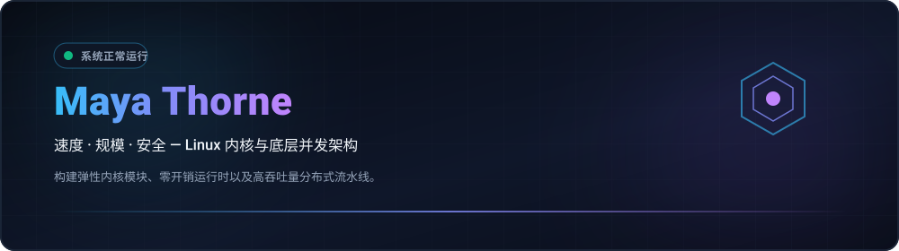

  
  

  <strong>Architecting Resilient Low-Level Systems, Kernel Modules &amp; High-Throughput Concurrency Primitives.</strong> 
  Speed · Scale · Security — Engineering with clarity and conviction. 🚀 ( •̀ᴗ•́ )و

  <a href="../README.md">🇺🇸 English</a> · <a href="./ko.md">🇰🇷 한국어</a> · <strong>🇨🇳 中文</strong> · <a href="./es.md">🇪🇸 Español</a> · <a href="./hi.md">🇮🇳 हिन्दी</a> 
  <a href="./ar.md">🇸🇦 العربية</a> · <a href="./pt-BR.md">🇧🇷 Português</a> · <a href="./ru.md">🇷🇺 Русский</a> · <a href="./fr.md">🇫🇷 Français</a> · <a href="./id.md">🇮🇩 Bahasa Indonesia</a>

  
  
  
  

---

<!-- 快捷导航栏 -->

  <a href="#about-engineering-ethos"><b>⚡ 简介</b></a> &nbsp;•&nbsp;
  <a href="#core-systems-architecture"><b>🚀 13个仓库全景</b></a> &nbsp;•&nbsp;
  <a href="#featured-capabilities"><b>⚙️ 核心能力</b></a> &nbsp;•&nbsp;
  <a href="#technology-stack"><b>💻 技术栈</b></a> &nbsp;•&nbsp;
  <a href="#explore-projects"><b>🗺️ 路线图</b></a> &nbsp;•&nbsp;
  <a href="#architecture-dashboard"><b>📊 架构指标</b></a> &nbsp;•&nbsp;
  <a href="#repository-structure"><b>📂 仓库结构</b></a>

---

<h2 style="display:inline-block; margin:0;">简介与工程理念</h2>

 

架构高弹性底层软件系统、Linux内核模块及高吞吐并发原语。追求机械同理心与零开销性能：

- **零成本与机械同理心** — 遵循CPU缓存层次结构、内存对齐与分支预测器的严谨代码，默认零开销抽象。
- 🐧 **内核优先架构** — 将操作系统内核视为第一类执行基座，深度运用 io_uring、eBPF 及无锁队列。
- **不变量驱动的正确性** — 编译期安全保证、确定性状态机转换、无锁环形缓冲区及持续模糊测试。

  <em>(⌐■_■) 💻 "信赖终端，追求确定性，消除冗余摩擦。"</em>

---

<h2 style="display:inline-block; margin:0;">🚀 核心系统与基础设施架构</h2>

 

涵盖 5 大核心研究领域的高性能分布式运行时、内核旁路网络原语以及密码学验证的基础设施拓扑引擎：

### ⚡ 底层系统与内核原语

<table>
  <tr>
    <td width="50%" valign="top">
      

        
      

      <h4><a href="https://github.com/maya-thorne/ring-io">⚡ ring-io</a></h4>
      
<em>基于 Linux io_uring (C23) 的高吞吐量、零开销异步 I/O 引擎。</em>

      

        
        
        
      

      <ul>
        <li>🌀 <strong>零系统调用环形队列</strong>: 无锁提交 (SQ) 与完成 (CQ) 环形缓冲区，消除 epoll/kqueue 切换开销</li>
        <li>⚡ <strong>内核轮询引擎</strong>: 内核态 SQPOLL 工作线程实现 2.85 Mops/sec 批处理吞吐量</li>
        <li>🔒 <strong>确定性内存模型</strong>: 纯 C23 架构、CPU 缓存行对齐数据结构及零动态分配运行时</li>
      </ul>
    </td>
    <td width="50%" valign="top">
      

        
      

      <h4><a href="https://github.com/maya-thorne/github-org-map">🗺️ github-org-map</a></h4>
      
<em>基于加盐 SHA-256 隐私哈希的 Linux 内核与并发运行时仓库每日自动拓扑映射引擎。</em>

      

        
        
        
      

      <ul>
        <li>🔄 <strong>持续拓扑制图</strong>: 定时 GitHub Actions 工作流自动化绘制内核研究与系统仓库网络</li>
        <li>🛡️ <strong>单向哈希脱敏</strong>: 加盐 SHA-256 哈希有效隐藏私有内核漏洞研究，同时保留演进谱系</li>
        <li>📊 <strong>原生矢量遥测</strong>: 零依赖原生 2D SVG 坐标计算引擎，生成逐帧精确的时间线动画</li>
      </ul>
    </td>
  </tr>
  <tr>
    <td colspan="2" valign="top">
      

        
      

      <h4><a href="https://github.com/maya-thorne/github-org-map-private">🔒 github-org-map-private</a></h4>
      
<em>用于底层内核模块、漏洞防御分析和私有架构研究的隔离伴随遥测流水线。</em>

      

        
        
        
      

      <ul>
        <li>🔐 <strong>硬件绑定安全库</strong>: Windows DPAPI 加密封装主凭据，确保密钥物理硬件级别隔离</li>
        <li>⚡ <strong>确定性不变量断言</strong>: 基于属性的自动化测试框架，机械证明抗原像性与无碰撞映射</li>
        <li>📜 <strong>双重真实基准审计</strong>: 持续审计流水线，严格验证公开脱敏产物与内部完整拓扑图的 1:1 一致性</li>
      </ul>
    </td>
  </tr>
</table>

### 🔬 二进制逆向工程与加壳分析

<table>
  <tr>
    <td width="50%" valign="top">
      

        
      

      <h4><a href="https://github.com/maya-thorne/bat2exe-ghidra-forensics">🔬 bat2exe-ghidra-forensics</a></h4>
      
<em>Ghidra MCP PE 二进制逆向工程（UPX/CLR/VB6 Bat2Exe 加壳分析）、8 大混淆器源码剖析与多阶段 AST 反混淆引擎。</em>

      

        
        
        
      

      <ul>
        <li>🔬 <strong>Ghidra MCP PE 反汇编</strong>: 深度拆解 bat2exe_12.exe (UPX), example.exe (.NET CLR), BEDeCode.exe (VB6) 二进制结构</li>
        <li>🛠️ <strong>8 大核心工具源码解构</strong>: 逐行剖析 BatCloak 多语言多格式载荷、Somalifuscator、0xidiz3r、Exorcism API 钩子</li>
        <li>⚡ <strong>多阶段 AST 引擎</strong>: 自动化 6 阶段静态反混淆器 (src/deobfuscator_engine.py) 与企业级 Sigma/YARA 规则集</li>
      </ul>
    </td>
    <td width="50%" valign="top">
      

        
      

      <h4><a href="https://github.com/maya-thorne/dotnet-packer-forensics">🔬 dotnet-packer-forensics</a></h4>
      
<em>面向商业 .NET 保护器的无执行静态取证脱壳工具、CLR 元数据分析、PE 附加段提取与双重 XOR 研究存档。</em>

      

        
        
        
      

      <ul>
        <li>📑 <strong>PE 附加段静态提取</strong>: 纯 Python 检测器，精准识别并剥离超出物理 PE 节边界的隐匿载荷</li>
        <li>🔑 <strong>双重 XOR 自动解密</strong>: 自动分析密钥，提取并还原 xorPacker / xorStub 加密的 PE 容器</li>
        <li>🔍 <strong>CLR 元数据指纹识别</strong>: 无需执行即可对 ConfuserEx、.NET Reactor、Babel、Eazfuscator 等加壳程序进行精准指纹标记</li>
      </ul>
    </td>
  </tr>
  <tr>
    <td colspan="2" valign="top">
      

        
      

      <h4><a href="https://github.com/maya-thorne/batch-deobfuscator-re">🔬 batch-deobfuscator-re</a></h4>
      
<em>多阶段批处理反混淆引擎、Ghidra PE 脱壳取证（UPX/LZMA/XOR 覆盖层）及 48+ 开源参考资料存档。</em>

      

        
        
        
      

      <ul>
        <li>🌀 <strong>不动点 AST 反混淆器</strong>: 多阶段迭代规约器，彻底剥离嵌套变量切片、脱字号转义与字符拼接</li>
        <li>🗜️ <strong>静态 PE 容器提取器</strong>: 提取并还原封装在编译二进制文件中的 UPX、LZMA 与 XOR 覆盖层原始脚本</li>
        <li>📚 <strong>旗舰分析与语料库</strong>: 深度解构 7 大主流反混淆引擎，整合 48+ GitHub 开源项目及 AI 训练语料</li>
      </ul>
    </td>
  </tr>
</table>

### 🛡️ 编译器与 AST 混淆研究

<table>
  <tr>
    <td width="50%" valign="top">
      

        
      

      <h4><a href="https://github.com/maya-thorne/batch-obfuscation-research">🛡️ batch-obfuscation-research</a></h4>
      
<em>Windows 批处理 (cmd.exe) 混淆、反混淆与二进制逆向工程 30 年大师级档案（1990 年代–2026）。</em>

      

        
        
        
      

      <ul>
        <li>📜 <strong>30 年演进全景档案</strong>: 48+ 开源工具镜像、Mandiant/Daniel Bohannon 前沿研究及 Hugging Face AI 逆向数据集</li>
        <li>🧠 <strong>cmd.exe 5 阶段解析机制</strong>: 详解变量展开顺序、脱字号剥离与下推自动机状态机</li>
        <li>🌐 <strong>10 种语言本地化支持</strong>: 配备暗黑终端霓虹风格 SVG 标头与完整多语言工程白皮书</li>
      </ul>
    </td>
    <td width="50%" valign="top">
      

        
      

      <h4><a href="https://github.com/maya-thorne/dotnet-obfuscation-and-ghidra-re">🛡️ dotnet-obfuscation-and-ghidra-re</a></h4>
      
<em>蓝队 EDR/SIEM 检测工程、52 条 Sigma 规则、32 条 YARA 签名、CIL 元数据取证与 Ghidra 二进制逆向套件。</em>

      

        
        
        
      

      <ul>
        <li>🛡️ <strong>dnlib 与 AntiTamper 取证</strong>: 静态识别 JIT 方法加密、AntiDump 内存擦除与损坏的 #~ 表流头部</li>
        <li>⚙️ <strong>Ghidra CIL 控制流重构</strong>: 定位自定义本地原生虚拟机的调度分发循环与 JIT 解密挂钩</li>
        <li>📊 <strong>企业级 SOC 规则库</strong>: 52 条模块化 Sigma 规则与 32 条 YARA 签名，全方位覆盖商业加壳逃逸手法</li>
      </ul>
    </td>
  </tr>
  <tr>
    <td colspan="2" valign="top">
      

        
      

      <h4><a href="https://github.com/maya-thorne/cmd-ast-deobfuscator">🛡️ cmd-ast-deobfuscator</a></h4>
      
<em>适用于 Windows 命令脚本 (cmd.exe / .bat) 的多阶段抽象语法树 (AST) 与词法反混淆引擎。</em>

      

        
        
        
      

      <ul>
        <li>🧩 <strong>多阶段词法解析器</strong>: 下推自动机精确处理嵌套脱字号 (^)、百分号切片与感叹号延迟变量展开</li>
        <li>⚡ <strong>零执行安全规范化</strong>: 纯内存仿真计算，无需启动命令行解释器即可还原恶意载荷</li>
        <li>🛡️ <strong>取证分析协同链路</strong>: 与 Ghidra 逆向分析成果及端点遥测检测规则全面打通联动</li>
      </ul>
    </td>
  </tr>
</table>

### 🔍 防御检测工程与蓝队取证

<table>
  <tr>
    <td width="50%" valign="top">
      

        
      

      <h4><a href="https://github.com/maya-thorne/batch-forensics-and-ghidra-re">🛡️ batch-forensics-and-ghidra-re</a></h4>
      
<em>蓝队 EDR/SIEM 检测工程、52 条 Sigma 规则、32 条 YARA 签名、香农熵与脱字号密度评分引擎。</em>

      

        
        
        
      

      <ul>
        <li>📐 <strong>香农熵与脱字号密度评分器</strong>: 纯 Python 静态检测器 (src/entropy_detector.py)，计算字符偏斜度与混淆熵值</li>
        <li>🔍 <strong>Sysmon 与 Event 4688 全覆盖</strong>: 52 条覆盖 MITRE ATT&CK 防御规避、执行与持久化战术的 Sigma 规则</li>
        <li>🚀 <strong>防御型 5 阶段语法模拟器</strong>: 零执行命令反转义器 (src/cmd_parser_simulator.py)，支持自动化 SOC 研判</li>
      </ul>
    </td>
    <td width="50%" valign="top">
      

        
      

      <h4><a href="https://github.com/maya-thorne/chromium-app-spoofing-forensics">🛡️ chromium-app-spoofing-forensics</a></h4>
      
<em>蓝队 EDR/SIEM 检测工程、52 条 Sigma 规则、32 条 YARA 签名、[MS-SHLLINK] 二进制提取与窗口类伪装审计框架。</em>

      

        
        
        
      

      <ul>
        <li>📑 <strong>[MS-SHLLINK] 二进制解析提取</strong>: 纯 Python 解析器，精确提取 ShellLinkHeader、ExtraData 块与图标位置伪装数据</li>
        <li>🔍 <strong>窗口类层级关系审计</strong>: 识别剥离原生边框伪装为 Microsoft Teams 或 Office 的 Chrome_WidgetWin_1 异常窗口</li>
        <li>⚡ <strong>开箱即用 SIEM 查询流</strong>: 提供可直接部署至 SOC 大屏的生产级 Splunk SPL 与 Elasticsearch KQL 规则</li>
      </ul>
    </td>
  </tr>
</table>

### 🌐 虚拟化、逃逸取证与个人资料架构中心

<table>
  <tr>
    <td width="50%" valign="top">
      

        
      

      <h4><a href="https://github.com/maya-thorne/browser-in-the-browser-virtualization">🌐 browser-in-the-browser-virtualization</a></h4>
      
<em>客户端 DOM 虚拟化、合成 Omnibox 地址栏 UI 欺骗、可拖拽物理引擎与多层防御启发式研究。</em>

      

        
        
        
      

      <ul>
        <li>🪟 <strong>DOM 窗口虚拟化架构</strong>: 仿真操作系统标题栏、拖拽物理效果与 z-index 9999 层叠上下文深度分析</li>
        <li>🔬 <strong>静态与启发式扫描器</strong>: 基于 Python AST 识别合成地址栏，并审计 CSP frame-ancestors 'none' 策略防御强度</li>
        <li>🛡️ <strong>企业级防御矩阵</strong>: 框架破解反制陷阱 (Frame-busting)、MutationObserver DOM 防篡改及多显示器逃逸检测</li>
      </ul>
    </td>
    <td width="50%" valign="top">
      

        
      

      <h4><a href="https://github.com/maya-thorne">💎 maya-thorne (个人主页与研究中心)</a></h4>
      
<em>专用 GitHub 个人主页仓库、10 种语言动态制图架构与自动化遥测同步引擎。</em>

      

        
        
        
      

      <ul>
        <li>🌐 <strong>10 国语言完整矩阵</strong>: 同步支持阿、英、西、法、印、印尼、韩、葡、俄、简中等技术主页</li>
        <li>📊 <strong>动态矢量徽章体系</strong>: 硬件加速级 SVG 徽章、连续提交统计图与密码学拓扑网络深度整合</li>
        <li>🏛️ <strong>统一研究分类架构</strong>: 有机串联 12 个底层系统、逆向工程与防御检测工程核心代码仓库</li>
      </ul>
    </td>
  </tr>
</table>

  <a href="https://github.com/maya-thorne?tab=repositories">浏览公开仓库</a> ·
  <a href="https://github.com/maya-thorne/github-org-map">探索系统拓扑</a>

---

<h2 style="display:inline-block; margin:0;">核心架构与技术能力</h2>

 

<table>
  <tr>
    <td width="50%" valign="top">
      <h4>🐧 内核与底层原语</h4>
      
<em>基于 io_uring 的异步 I/O、内核旁路网络及实时可观测性。</em>

      <ul>
        <li>🌀 <strong>io_uring 异步 I/O</strong>：消除传统 epoll 系统调用开销的高吞吐提交/完成环形队列。</li>
        <li>⚡ <strong>内核旁路与 XDP</strong>：可编程 eBPF/XDP 快速路径数据包过滤与 DPDK 用户态加速。</li>
        <li>🔒 <strong>无锁原语</strong>：SPMC/MPSC 原子队列、风险指针与内存屏障同步。</li>
      </ul>
    </td>
    <td width="50%" valign="top">
      <h4>🌐 分布式系统与并发</h4>
      
<em>现代 CSP 风格并发管道、零拷贝序列化与内存安全系统软件。</em>

      <ul>
        <li><strong>系统工程工具链</strong>：现代 C23、异步与 unsafe Rust (no_std) 及 Zig 工具链。</li>
        <li>📦 <strong>零拷贝数据流</strong>：基于 NVMe 存储与高带宽网络的缓存对齐序列化。</li>
        <li>🧪 <strong>不变量验证</strong>：状态自动机验证、属性测试与自动化模糊测试套件。</li>
      </ul>
    </td>
  </tr>
</table>

---

<h2 style="display:inline-block; margin:0;">技术栈与工具链</h2>

 

<em>面向高性能系统与裸机运行环境的工程工具链：</em>

<table>
  <tr>
    <td width="50%" valign="top">
      <h4>⚙️ 底层与系统</h4>
      <ul>
        <li>🔤 <strong>编程语言</strong>：C23、Rust (Async / Unsafe / no_std)、Zig、x86_64 / ARM64 汇编</li>
        <li>🐧 <strong>内核运行时</strong>：Linux 内核模块、POSIX API、eBPF / XDP、io_uring</li>
        <li>🧠 <strong>内存与并发</strong>：无锁原子操作、SIMD 向量化、NUMA 感知分配器</li>
      </ul>
    </td>
    <td width="50%" valign="top">
      <h4>🌐 分布式与基础设施</h4>
      <ul>
        <li><strong>网络技术</strong>：内核旁路 (DPDK)、epoll/kqueue、WebSockets、gRPC</li>
        <li>🔍 <strong>可观测性</strong>：bpftrace、perf、Valgrind、GDB、Prometheus 遥测</li>
        <li>🖥️ <strong>开发环境</strong>：Arch Linux、Debian、Docker、LLVM/Clang 工具链、Neovim / Tmux</li>
      </ul>
    </td>
  </tr>
</table>

 

  

---

<h2 style="display:inline-block; margin:0;">项目路线图与演进</h2>

 

<strong>组织地图与拓扑结构</strong>

  

  私有存储库仅以掩码标签形式受保护展示。 
  <a href="https://github.com/maya-thorne/github-org-map">探索拓扑与制图详情 →</a>

 

<em>底层基础设施领域的演进路线与关键技术倡议：</em>

<ul>
  <li><strong>当前核心任务</strong>：io_uring 多环轮询基准测试与内核模块模糊测试套件</li>
  <li><strong>下一里程碑</strong>：集成 NUMA 内存绑定的无锁 SPMC 工作窃取调度器</li>
  <li>🔬 <strong>研究方向</strong>：具备硬件卸载支持的 eBPF 网络流路由器</li>
</ul>

---

<h2 style="display:inline-block; margin:0;">架构仪表盘与交付指标</h2>

 

  

    
    
  

---

<h2 style="display:inline-block; margin:0;">📁 个人资料仓库结构与目录映射</h2>

 

<table width="100%">
  <thead>
    <tr>
      <th width="30%" align="left"><nobr>📁 路径 / 资产</nobr></th>
      <th width="20%" align="left"><nobr>⚙️ 类别</nobr></th>
      <th width="50%" align="left"><nobr>📝 工程职责与规范</nobr></th>
    </tr>
  </thead>
  <tbody>
    <tr>
      <td><strong><code>assets/projects/</code></strong></td>
      <td>矢量资产</td>
      <td>覆盖全部13个系统研究仓库的高分辨率SVG项目横幅（100% XML有效）</td>
    </tr>
    <tr>
      <td><strong><code>assets/badges/</code></strong></td>
      <td>可视化遥测</td>
      <td>表示研究重点、遥测状态与安全规范的自定义矢量徽章</td>
    </tr>
    <tr>
      <td><strong><code>assets/stats/</code></strong></td>
      <td>指标遥测</td>
      <td>实时系统架构与贡献遥测SVG徽章</td>
    </tr>
    <tr>
      <td><strong><code>locales/</code></strong></td>
      <td>国际化多语言</td>
      <td>10种语言的全球本地化个人资料主页（<code>ar</code>, <code>en</code>, <code>es</code>, <code>fr</code>, <code>hi</code>, <code>id</code>, <code>ko</code>, <code>pt-BR</code>, <code>ru</code>, <code>zh-CN</code>）</td>
    </tr>
    <tr>
      <td><strong><code>avatar.svg</code></strong></td>
      <td>品牌资产</td>
      <td>Maya Thorne 简洁几何矢量徽标</td>
    </tr>
    <tr>
      <td><strong><code>hero.svg</code></strong></td>
      <td>品牌资产</td>
      <td>响应式宽屏终端主题主横幅</td>
    </tr>
    <tr>
      <td><strong><code>.gitignore</code></strong></td>
      <td>安全隔离边界</td>
      <td>拦截AI记忆、凭据及OS缓存文物的零泄漏隔离边界</td>
    </tr>
    <tr>
      <td><strong><code>LICENSE</code></strong></td>
      <td>法律许可证</td>
      <td>Maya Thorne Systems &amp; Security Research License (MT-SRL)</td>
    </tr>
    <tr>
      <td><strong><code>README.md</code></strong></td>
      <td>主入口文件</td>
      <td>汇聚5大系统领域13个研究仓库的核心GitHub主页大屏</td>
    </tr>
  </tbody>
</table>

---

## 交流与合作

欢迎就底层系统架构、Linux 内核机制及高性能并发原语展开深入交流与探讨。

🐙 [GitHub 主页](https://github.com/maya-thorne) · 📦 [公开存储库](https://github.com/maya-thorne?tab=repositories) · 💬 [讨论区](https://github.com/maya-thorne?tab=discussions) · ✉️ [发送邮件](mailto:zse4123jo@gmail.com)

   
  © 2026 Maya Thorne · 系统架构与内核工程 ( 💻 ˘◡˘ )

